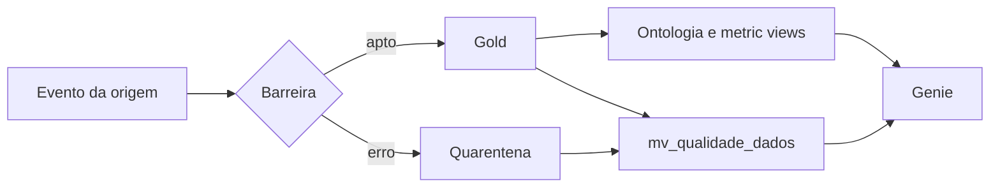

# 05 · Skills: linhagem do estudo, aplicação e ganhos

> Mapa de **24/11/2026**. Diz quais skills foram consultadas, onde cada uma entrou no projeto (fase, prática e pasta),
> o ganho medido de cada uma e como elas ajudam na governança, nas métricas de qualidade, no plano de ação para os
> dados ruins e na Genie.

## O que são e como foram usadas

As skills são instruções empacotadas que um agente de código lê antes de agir. As deste projeto vêm do
[ai-dev-kit](https://github.com/databricks-solutions/ai-dev-kit), hoje distribuído como Databricks AI Tools
(`databricks aitools install`), e foram usadas pelo Claude Code com o plugin `databricks` 0.2.28. O catálogo de
referências já registrava o ai-dev-kit como "a origem das skills Databricks usadas neste projeto"
([OPCOES_PARA_LLM.md](../referencias/databricks_solutions/OPCOES_PARA_LLM.md), opção 3). Faltava dizer qual skill
entrou em qual etapa e o que cada uma rendeu. Este documento preenche essa lacuna.

A regra seguida em todas as fases foi esta: **antes de criar ou mudar um tipo de recurso, ler a skill dele e as
referências que ela indica**. Por exemplo: pipeline, job, bundle, metric view, espaço Genie, painel, app ou Lakebase.
A skill traz a sintaxe atual da API e as armadilhas conhecidas. Sem ela, o agente escreveria a partir de memória
desatualizada.

**De onde vem a lista.** As chamadas de skill ficam registradas nas conversas do projeto. Foram 11 skills
Databricks:

| Skill | Para que serve |
|---|---|
| `databricks-core` | CLI, autenticação, perfis e bundles; é a skill de entrada |
| `databricks-pipelines` | Lakeflow Spark Declarative Pipelines e Auto CDC |
| `databricks-jobs` | Lakeflow Jobs |
| `databricks-serverless` | computação serverless para jobs e pipelines |
| `databricks-dabs` | Declarative Automation Bundles |
| `databricks-unity-catalog` | governança, grants, tags e tabelas de sistema |
| `databricks-metric-views` | metric views do Unity Catalog |
| `databricks-genie-agents` | espaços Genie: criar, avaliar, diagnosticar e otimizar |
| `databricks-aibi-dashboards` | painéis AI/BI |
| `databricks-apps` | Databricks Apps |
| `databricks-lakebase` | Lakebase Postgres |

As referências mais lidas foram as de três skills, todas da camada de consumo:

| Skill | Referências consultadas |
|---|---|
| `databricks-genie-agents` | `serialized-space.md` (formato do espaço), `create-genie-agent.md`, `optimize-genie-agent.md`, `query-genie-agent.md`, `diagnose-genie-agent.md` |
| `databricks-aibi-dashboards` | `1-widget-specifications.md`, `3-filters.md`, `4-examples.md` |
| `databricks-metric-views` | `create-patterns.md`, `query-patterns.md` |

---

## Mapa: skill, onde entrou e ganho medido

A ligação com as fases da [trilha](01_TRILHA_DE_APRENDIZAGEM.md) e com as práticas do [framework](04_FRAMEWORK.md)
foi feita em 24/11 a partir do conteúdo de cada fase.

| Skill | Fases | Práticas | Onde está | Ganho medido (prova) |
|---|---|---|---|---|
| `databricks-core` | 0, 21 | P01, P02, P03 | perfil `dbx-workshop`, [AGENTS.md](../AGENTS.md) | um perfil para tudo; nenhum segredo no repositório público, com varredura antes de cada push |
| `databricks-pipelines` | 2, 3, 4 | P05, P06, P07, P09 | [`medalhao/`](../medalhao/README.md) | 1,72 mi eventos na bronze; Auto CDC monta a história; a barreira separou 6.712 eventos com erro, cada um com o motivo |
| `databricks-jobs` | 3, 16, 19 | P02, P11, P20 | [`carga_diaria/`](../carga_diaria/README.md) | o portão roda os 36 cenários antes da carga; se um falha, a carga não roda; o Studio avalia 12 tabelas depois da carga |
| `databricks-serverless` | 3, 5, 16 | P01, P02 | `carga_diaria/databricks.yml`, `dqx_studio/` | jobs e tarefas do Studio sem cluster para administrar no Free Edition |
| `databricks-dabs` | 2, 3, 6, 11, 20 | P02, P12, P22 | 4 bundles: `medalhao`, `carga_diaria`, `paineis_financeiros`, `dqx_studio/painel` | implantação repetível; o painel mantém o mesmo link a cada deploy |
| `databricks-unity-catalog` | 8, 14, 15, 17, 22, 23, 24 | P13 a P17, P30, P35, P37 | [`governanca/`](../governanca/README.md), [`finops/`](../finops/README.md), [`conformidade/`](../conformidade/README.md) | 1.977 de 1.977 colunas principais e 682 de 682 legadas descritas; `dado_pessoal` em 380 + 152 colunas; 28 regras de conformidade; US$ 1.229 com dono atribuído |
| `databricks-metric-views` | 9, 18, 20 | P18, P19, P23 | `governanca/ontologia.py`, `gerar_ontologia_sql.py` | 4 metric views, fonte única para Genie, painéis e Power BI (paridade 21 de 21 em 22/11; 20 de 21 em 24/11, L86) |
| `databricks-genie-agents` | 10, 13 | P21, P24 | `governanca/genie.py`, [triagem](../governanca/genie/avaliacao_boas_praticas/TRIAGEM.md) | 29 de 29 perguntas de avaliação certas (21/11); 28 de 29 com os dados até 09/01 (24/11, L87); as 3 de qualidade certas nas duas |
| `databricks-aibi-dashboards` | 6, 11, 20 | P12, P22 | [`dqx_studio/painel/`](../dqx_studio/painel/README.md), [`paineis_financeiros/`](../paineis_financeiros/README.md) | painel de qualidade com 8 semanas; 2 painéis financeiros por público, do mesmo gerador, com uma página por fato |
| `databricks-apps` | 5, 18 | P11, P25 | [`dqx_studio/`](../dqx_studio/README.md), [prontidão](../governanca/ontologia_readiness/RESULTADO.md) | DQX Studio com 194 checagens aprovadas; app de prontidão com nota 94,5 (começou em 81,3) |
| `databricks-lakebase` | 5, 18 | P11, P25 | projeto `dqx-studio-db` | guarda o estado do Studio e o histórico das notas de prontidão |

---

## Como ajudam em cada frente

### Governança

**Skills:** `databricks-unity-catalog`, `databricks-metric-views` e `databricks-genie-agents`.

- **Descrição e tags.** Todas as colunas das camadas principais e do legado têm descrição (1.977 e 682). As tags
  governadas dizem domínio, dono e área de negócio (P13, P14, P16).
- **Dado pessoal (LGPD).** O dado pessoal está marcado por tag em 380 colunas principais e 152 legadas, sem máscara,
  por decisão: a validação usa os valores reais (P15). A ontologia que a Genie lê não tem identificador pessoal (P17).
- **Conformidade medida.** São 28 regras em 7 dimensões, com cerca de 9 mil verificações por dia (8.992 em 23/11):
  13 atendem, 12 estão em atenção e 3 são críticas. Cada regra traz meta, severidade, origem e como corrigir (P35, P37).
  As visões ficam em `pos_venda.conformidade`.
- **Custo com dono.** As tabelas de sistema viram custo por time no padrão FOCUS (P30, P31). O achado principal:
  dois terços do custo do workspace vêm de 5 alertas SQL de outro time.

### Métricas de qualidade dos dados

**Skills:** `databricks-pipelines`, `databricks-apps`, `databricks-lakebase`, `databricks-aibi-dashboards` e
`databricks-metric-views`.

| Camada | Métrica | Onde ver |
|---|---|---|
| Barreira no pipeline (primeira linha) | eventos barrados por um de 11 motivos de erro; avisos entram marcados | quarentena da silver e `gold.dq_barrados_por_motivo_dia` |
| DQX Studio (segunda linha) | Registro de Regras com 69 modelos, 12 tabelas monitoradas e 194 checagens aprovadas, sempre com todas as linhas e janela de 7 dias; das 224 regras do catálogo de exemplos, 138 já têm exemplo e as 86 em zero são garantias da arquitetura | `main.dqx_studio.dq_metrics` e o [roteiro](../dqx_studio/demo/ROTEIRO.md) |
| Painel de qualidade | 8 semanas de regras violadas, uma história por semana | [`dqx_studio/painel/`](../dqx_studio/painel/README.md) |
| Camada semântica | `mv_qualidade_dados`: eventos recebidos, aptos e barrados, taxa de barrados, duplicatas, e-mail ausente, CPF inválido, CEP malformado e forma de pagamento não cadastrada | `pos_venda.ontologia` e os dois espaços Genie |

**Aprendizado que mudou a métrica (P11).** Por amostra de 10 mil linhas, como vinha de fábrica, o Studio nunca acusou
as linhas órfãs da fato. Com todas as linhas, achou 1.439 na semana 4 e 2.603 na semana 5.

### Plano de ação para os dados apontados como ruins

O achado já chega com o motivo. Na quarentena vem o motivo do erro; no Studio, a regra violada; na conformidade, o
como corrigir. Por isso, cada achado vira uma ação com dono e critério de pronto. O critério de pronto é a própria
regra voltar a zero ou chegar a 100%.

| Achado | Quem age | Ação | Resolvido quando |
|---|---|---|---|
| 6.712 eventos com erro na quarentena | sistema de origem | corrigir o evento na origem | os barrados do dia voltam a zero |
| 4.165 linhas da fato com forma de pagamento nova (criptomoeda, vale-refeição, transferência internacional) | dono do catálogo | cadastrar o código na dimensão | a regra de chave órfã volta a zero |
| 2.615 linhas com motivo e 754 com periodicidade fora do domínio | dono do domínio | incluir o valor no domínio ou corrigir na origem | a regra de domínio volta a zero |
| Cadastro ruim: 58 clientes com sexo X, 46 sem nascimento, itens de teste (`VIDA_QA_*`, `PV_QA_*`, `COR_QA_*`) | cadastro | corrigir o cadastro e tirar os itens de teste | as checagens da dimensão zeram |
| 17 ativos sem `subject_area` (TAG01, crítica) | squad pós-venda | aplicar as tags da política | TAG01 chega a 100% |
| 22 views quebradas no workspace (USO03, crítica) | dono de cada view | recriar a partir do código ou apagar | USO03 chega a 100% |
| R$ 779,34 de produto órfão fora da resposta da Genie (L87) | dono da ontologia | membro "Produto não identificado" na metric view | a pergunta por produto soma o saldo total |
| Início do mês somado por grupo no painel (L86) | dono do painel | calcular o crescimento no total, não por grupo | paridade com o Power BI volta a 21/21 |

A lista completa de governança, com severidade e como corrigir, está na visão
`pos_venda.conformidade.pendencias`.

**Lição da semana 5.** A origem se corrigiu e os barrados zeraram em 22/12. Mesmo assim, as linhas órfãs da fato
continuaram enquanto as pendências seguiam abertas. Corrigir só a origem não limpa o que já entrou: o dono do catálogo
também precisa agir.

### Qualidade para a Genie

**Skills:** `databricks-genie-agents`, `databricks-metric-views` e `databricks-unity-catalog`.

- **Só dado apto nas respostas.** A Genie lê a ontologia, que vem da gold. A gold só recebe o que passou pela
  barreira, então um evento com erro nunca vira resposta.
- **A qualidade também é assunto da Genie.** Os dois espaços, do diretor e do analista, têm a `mv_qualidade_dados`.
  O espaço do diretor sugere a pergunta "A qualidade dos dados afetou os números de dezembro?".
- **Avaliado.** 3 das 29 perguntas de avaliação são sobre qualidade, e as 3 acertaram em 21/11 e de novo em 24/11,
  com os dados até 09/01/2027:
  - taxa de barrados por semana de dezembro (diretor): 0,8%, 3,1%, 1,5%, 1,2% e 8,4% nas semanas de 30/11, 7/12,
    14/12, 21/12 e 28/12;
  - eventos com forma de pagamento não cadastrada em dezembro (diretor): 867;
  - eventos barrados em dezembro por motivo da rejeição (analista).
- **Entende o negócio.** Colunas descritas, nenhum identificador pessoal na ontologia, as mesmas funções de regra da
  carga (P20) e prontidão 94,5 para a Genie Ontology (P25).
- **Reconferência (24/11).** Com os dados até 09/01/2027, a Genie acertou 28 de 29. A que errou também é efeito de
  qualidade: ela filtrou produto não nulo e deixou de fora R$ 779,34 de linhas com produto órfão (L87). O plano de ação
  ganhou um item: dar à chave órfã um membro explícito na ontologia.

---

## Como reaplicar em outro domínio

Use as skills nesta ordem. Cada uma abre uma camada, e o critério de saída de cada camada está no
[playbook](02_PLAYBOOK.md).

1. `databricks-core`: perfil, autenticação e limites da plataforma.
2. `databricks-pipelines`: medalhão, Auto CDC e barreira.
3. `databricks-jobs` com `databricks-serverless`: carga diária com portão de regras.
4. `databricks-dabs`: tudo em bundle, com agendas pausadas.
5. `databricks-unity-catalog`: descrições, tags, dado pessoal, conformidade e custo.
6. `databricks-metric-views`: métricas numa fonte única, incluindo as de qualidade.
7. `databricks-genie-agents`: espaços por público, com avaliação e triagem.
8. `databricks-aibi-dashboards`: painéis por público e painel de qualidade.
9. `databricks-apps` com `databricks-lakebase`: DQX Studio e app de prontidão.

## Limites deste mapa

- A lista vem das chamadas registradas nas conversas do projeto. Algumas etapas foram feitas sem uma skill dessas:
  - os dados sintéticos, gerados com dbldatagen;
  - o projeto Power BI;
  - a pesquisa no catálogo databricks-solutions.

  Essas etapas não aparecem no mapa.
- A ligação entre skill, fase e prática é uma leitura do conteúdo de cada fase, não um registro automático.
- A Genie e o Power BI foram reconferidos em 24/11 com os dados até 09/01/2027: 28/29 e 20/21 (L86, L87).

## Fontes

- [ai-dev-kit](https://github.com/databricks-solutions/ai-dev-kit) (databricks-solutions), origem das skills.
- [OPCOES_PARA_LLM.md](../referencias/databricks_solutions/OPCOES_PARA_LLM.md), opção 3: ai-dev-kit.
- [Framework](04_FRAMEWORK.md) (P##), [trilha](01_TRILHA_DE_APRENDIZAGEM.md) (fases 0 a 26) e
  [CHANGELOG](CHANGELOG.md), para os números.
