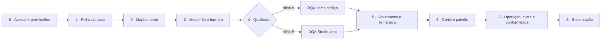

# 06 · Guia: aplicar o framework a uma base bruta de pendências de pagamento

> Guia de **24/11/2026**, para você e para um agente de código (GitHub Copilot, Claude Code, Codex, Cursor). Ele leva
> tudo o que foi aplicado no pos_venda para uma **base bruta de pendências de pagamento que já está no Databricks**,
> num cenário que pode ser diferente. A qualidade tem dois caminhos separados: **DQX como código** e **DQX Studio
> como app**.
>
> **Guia × spec.** Este guia explica o porquê de cada passo. O contrato que o agente executa é o
> [spec](../specs/aplicar-base-bruta/SPEC.md): tarefas com verificação, saídas, gates de aprovação e o progresso
> registrado em `specs/<nome-da-base>/` (ficha, mapeamento, decisões e tarefas).

## Como usar com o Copilot

1. Abra este repositório no VS Code com o GitHub Copilot Chat em modo agente.
2. O Copilot lê sozinho o [`.github/copilot-instructions.md`](../.github/copilot-instructions.md). Esse arquivo manda
   ler o [AGENTS.md](../AGENTS.md) e este guia.
3. No chat, digite `/aplicar-base-bruta`, o prompt de [`.github/prompts/`](../.github/prompts/aplicar-base-bruta.prompt.md).
   Se o comando não aparecer, cole o [prompt inicial](#prompt-inicial-para-colar-no-copilot) do fim deste guia.
4. O agente cria `specs/<nome-da-base>/` a partir dos modelos e segue `TAREFAS.md`. Ele para em cada gate (G1 a G9)
   e, no fim de cada etapa, mostra o critério de aceite. Para retomar outro dia, rode o prompt de novo.

**Regras para o agente** (as mesmas do [AGENTS.md](../AGENTS.md)):
- **Peça antes de gastar cota ou mudar o workspace:** rodar job, criar ou recriar objeto, deploy, ligar agenda,
  instalar app, commit ou push.
- **Nunca escreva na base bruta nem no schema dela.** Tudo o que for criado fica em catálogo ou schemas próprios.
- **Diga de onde tirou cada decisão:** prática (`P##`), módulo (`M#`), lição (`L##`) ou arquivo. Se o repositório não
  responde, diga isso; não invente.
- **Uma etapa por vez, com o critério de saída do [playbook](02_PLAYBOOK.md) conferido.**

---

## Visão geral



| Etapa | Módulos do playbook | Práticas | Skill para consultar antes |
|---|---|---|---|
| 0 · Acesso e permissões | M1 | P01, P02 | `databricks-core` |
| 1 · Ficha da base | Passo 0 | todas | `databricks-core` (`discover-schema`) |
| 2 · Mapeamento | M2 | P05, P06 | `databricks-unity-catalog` |
| 3 · Medalhão e barreira | M2, M3, M4, M10 | P05 a P10, P20 | `databricks-pipelines`, `databricks-jobs`, `databricks-dabs` |
| 4 · Qualidade (A ou B) | M5 | P11, P12, P38 | trilha A: docs do DQX; trilha B: `databricks-apps`, `databricks-lakebase` |
| 5 · Governança e semântica | M6, M7 | P13 a P19 | `databricks-unity-catalog`, `databricks-metric-views` |
| 6 · Genie e painéis | M8, M9 | P21 a P26 | `databricks-genie-agents`, `databricks-aibi-dashboards` |
| 7 · Operação, custo e conformidade | M9, M11, M12 | P28 a P37 | `databricks-unity-catalog`, `databricks-jobs` |
| 8 · Sustentação (antes de ligar as agendas) | M13 | P28, P40 | `databricks-jobs`, `databricks-aibi-dashboards` |

O que cada skill rendeu aqui está em [05 · Skills e ganhos](05_SKILLS_E_GANHOS.md).

---

## Etapa 0 · Acesso e permissões

Descubra o que você pode fazer antes de desenhar. A resposta decide, entre outras coisas, a trilha da qualidade.

```bash
databricks auth profiles                                   # escolha o perfil do workspace da base
databricks current-user me --profile <perfil>
databricks experimental aitools tools query --profile <perfil> "SHOW GRANTS ON CATALOG <catalogo_da_base>"
databricks experimental aitools tools query --profile <perfil> "SHOW GRANTS ON SCHEMA <catalogo_da_base>.<schema>"
```

| Pergunta | Se a resposta é não |
|---|---|
| Posso criar um catálogo? | use um catálogo existente e crie **schemas seus** (`<prefixo>_bronze`, `_silver`, `_gold`, `_ontologia`, `_dq`); deixe o catálogo como parâmetro (`CAT` nos geradores) |
| Posso criar schema no catálogo que vou usar? | peça ao dono do catálogo um schema já criado para cada camada, com `CREATE TABLE`, `CREATE FUNCTION` e `MODIFY` |
| Tenho `SELECT` na base bruta? | sem isso não há como começar; peça o acesso só de leitura |
| Posso criar job e pipeline? | rode os notebooks à mão até ter o acesso |
| Posso criar app e service principal, e **conceder** `USE CATALOG` e `CREATE SCHEMA` no catálogo (dono ou `MANAGE`)? | **use a trilha A** (DQX como código) |
| Tem serverless? | declare um `job_cluster` com DBR 15.4 ou mais novo nos bundles |

**Critério de saída:** perfil escolhido, catálogo e schemas de destino definidos, e a lista do que você pode e não
pode fazer.

---

## Etapa 1 · Ficha da base

O agente perfila a base, e você confirma.

```bash
databricks experimental aitools tools discover-schema <cat.schema.tabela> --profile <perfil>
```

Perfil mínimo em SQL: linhas por dia de extração, nulos por coluna, chaves duplicadas, valores distintos de status e
de forma de pagamento, faixa das datas e dos valores.

Preencha a ficha. Ela é o [Passo 0 do playbook](02_PLAYBOOK.md#passo-0--perfil-da-base) aplicado a pendências.

| Pergunta | pos_venda (referência) | Sua base |
|---|---|---|
| Como chega? | eventos diários (`NOVA`, `ATUALIZACAO`, `BAIXA`), append-only | |
| Tem chave da pendência? | `pendencia_id` | |
| Tem data do evento ou da foto? | `data_extracao` | |
| O que muda no tempo? | status, valores e atraso | |
| Medidas | saldo (posição, semiaditivo) e recuperado (fluxo) | |
| Dado pessoal | CPF, nome, contato, RG (sintéticos) | |
| O que torna o dado inutilizável? | as 11 regras de erro da barreira | |
| Quem consome? | diretoria e analista financeiro | |
| Onde roda? | Free Edition | |
| Trilha da qualidade | B (app instalado) | A ou B (etapa 0) |

**Critério de saída:** ficha preenchida e o perfil pronto mais parecido escolhido (A a E, no playbook).

---

## Etapa 2 · Mapeamento para o modelo do pos_venda

Ligue cada coluna da base bruta ao conceito que o framework usa. Uma coluna que não existe vira uma derivação, uma
regra de aviso ou "não se aplica".

| Conceito | Coluna no pos_venda | Sua coluna | Se não existir |
|---|---|---|---|
| chave da pendência | `pendencia_id` | | `xxhash64(apólice, parcela)` estável (P05) |
| data do evento ou da foto | `data_extracao` | | data da carga, gravada na bronze |
| tipo do evento | `tipo_evento` | | derivar comparando fotos (ver abaixo) |
| status | `status_cobranca` | | tabela de-para para os 6 status |
| vencimento e valor | `data_vencimento`, `valor_parcela` | | obrigatórios: sem eles não há pendência |
| encargos | `valor_multa`, `valor_juros`, `valor_total_pendente` | | calcular pelas funções de regra (P20) |
| atraso | `dias_atraso` | | `datediff(data_extracao, data_vencimento)` |
| baixa | `data_baixa`, `valor_pago` | | só avalia a regra de baixa se existir |
| catálogos | `forma_pagamento`, `periodicidade_pagamento`, `motivo_pendencia`, `canal_venda` | | dimensão com membro "não informado" |
| cadastro | `numero_apolice`, `produto_codigo`, `cliente_id`, `corretor_id`, `ponto_venda_codigo` | | dimensões SCD2 (perfil B) |
| dado pessoal | `cliente_cpf`, `cliente_nome`, contatos, `cliente_uf`, nascimento | | tag `dado_pessoal`; fora da ontologia (P15, P17) |

**Se a base é uma foto completa (sem eventos):**
- grave cada foto na bronze com a data;
- use o Auto CDC a partir de snapshot (skill `databricks-pipelines`) para montar a história;
- a `BAIXA` é a pendência que sumiu da foto ou que mudou para paga.

**Critério de saída:** tabela de mapeamento aprovada, com a decisão para cada coluna que falta.

---

## Etapa 3 · Medalhão e barreira (M2, M3, M4, M10)

- **Bronze:** só acrescenta (P06). Leia a base bruta e grave no seu schema, nunca na origem.
- **Funções de regra:** comece por elas (M10), em `<seu_catalogo>.regras`, com os cenários BDD e a paridade com o SQL
  antigo (P20, L56).
- **Barreira na silver:** cada evento ganha um motivo de rejeição; erro vai para a quarentena; aviso entra marcado
  (P09). O modelo é `MOTIVO_REJEICAO` em `carga_diaria/gerar_carga.py`.
- **Gold:** star schema com fato snapshot diária e chaves substitutas estáveis (P05, P07). O `RELY` fica só nas chaves
  primárias (P08).
- **Job diário:** o portão roda os cenários antes da carga, com a agenda nascendo pausada (P02).

**Critério de saída:** é o do playbook para M2, M3, M4 e M10. Os pontos-chave:
- o portão passa todos os cenários;
- quarentena + aptos = eventos da bronze;
- a fato bate com a silver na foto do dia.

---

## Etapa 4 · Qualidade: escolha uma trilha

As duas trilhas medem as **mesmas regras, com os mesmos nomes** da barreira. A diferença é onde as regras rodam e
quanta permissão cada uma pede. A barreira do pipeline (etapa 3) continua sendo a primeira linha nas duas.

| | Trilha A · DQX como código | Trilha B · DQX Studio como app |
|---|---|---|
| O que é | biblioteca `databricks-labs-dqx` num job | app do Databricks Labs, instalado pelo Marketplace ou pelo bundle oficial |
| Onde ficam as regras | YAML no repositório (`dqx_codigo/checks_pendencias.yml`) | Registro de Regras do app (estado no Lakebase) |
| Onde ficam os resultados | tabelas suas: válidos, quarentena, `dq_metricas_regras` | `main.dqx_studio.dq_*` (catálogo escolhido na instalação) |
| Interface | painel AI/BI sobre as tabelas de métricas | o app, com aprovação de regras, notas e histórico |
| Precisa de app, service principal e Lakebase | não | sim |
| Permissão no catálogo | `CREATE TABLE` e `MODIFY` num schema seu | quem instala precisa **conceder** ao service principal do app `USE CATALOG` e `CREATE SCHEMA` no catálogo (dono do catálogo ou `MANAGE`) |
| Vagas de app | nenhuma | 1 (Free Edition: no máximo 3) |
| Melhor para | sem acesso de dono ao catálogo; time que versiona tudo em Git | time que quer interface, aprovação de regra e histórico no app |
| Modelo no repositório | [`dqx_codigo/`](../dqx_codigo/README.md) | [`dqx_studio/`](../dqx_studio/README.md) |

**Regra de escolha.** Se a etapa 0 respondeu "não" a criar app e service principal, ou a conceder privilégio no
catálogo, use a **trilha A**. Ela não depende de ninguém além do dono do schema de destino. A migração para a trilha B
pode vir depois: as regras são as mesmas.

### Trilha A · DQX como código

1. **Candidatas.** Perfile uma amostra com `DQProfiler` e `DQGenerator` e revise as sugestões. Comando em
   [`dqx_codigo/README.md`](../dqx_codigo/README.md).
2. **Regras.** Copie `dqx_codigo/checks_pendencias.yml` e troque as colunas, os domínios e o catálogo das funções de
   regra.
3. **Janela.** Defina a janela (por exemplo, os últimos 7 dias) e avalie **todas as linhas** dela, sem amostra (P11).
4. **Job.** Faça o deploy do bundle `dqx_codigo/` com `tabela_entrada` e `schema_destino` seus. Rode-o numa janela
   conhecida e depois como tarefa no fim da carga.
5. **Painel.** Crie o painel de qualidade sobre `dq_metricas_regras`, com reprovadas por regra e por execução, e uma
   página por camada (P12, skill `databricks-aibi-dashboards`).

**Critério de saída:**
- o job roda SUCCESS;
- as regras de erro da quarentena do DQX batem com a quarentena da barreira na mesma janela;
- toda regra aparece em `dq_metricas_regras`, mesmo com zero.

### Trilha B · DQX Studio como app

Pré-requisitos, todos com quem administra o workspace:
- uma vaga de app;
- um projeto Lakebase;
- um SQL warehouse que o app possa usar;
- um service principal para o job do Studio, com o seu usuário como `servicePrincipal.manager` e
  `servicePrincipal.user`;
- os grants no catálogo: o app com `USE CATALOG` + `CREATE SCHEMA`, e o service principal com `USE CATALOG`.

O passo a passo está no [M5 do playbook](02_PLAYBOOK.md) e em [`dqx_studio/README.md`](../dqx_studio/README.md). Ele
inclui as views de janela, o Registro de Regras, as tabelas monitoradas e a agenda depois da carga.

**Critério de saída:** é o do M5. `registro_studio.py executar` termina com todas as execuções SUCCESS e nota
calculada, e a quarentena do pipeline é igual aos reprovados no Studio.

### Plano de ação (as duas trilhas)

Cada regra com reprovação vira uma ação com dono e critério de pronto, como no pos_venda
([05 · plano de ação](05_SKILLS_E_GANHOS.md#plano-de-ação-para-os-dados-apontados-como-ruins)):

| Achado | Quem age | Pronto quando |
|---|---|---|
| erro de formato | sistema de origem | os barrados do dia voltam a zero |
| código novo fora do catálogo | dono do catálogo | a regra de chave órfã volta a zero |
| cadastro ruim | cadastro | as checagens da dimensão zeram |
| pendência de governança | squad | a regra de conformidade chega a 100% |

Corrigir só a origem não limpa o que já entrou na fato. Por isso o catálogo e o cadastro também agem (lição da
semana 5).

---

## Etapa 5 · Governança e semântica (M6, M7)

Quatro passos:
- descrição em toda coluna, com auditoria (P13);
- tags de domínio, dono e área de negócio (P14), mais a tag `dado_pessoal` (P15);
- ontologia sem identificadores pessoais (P17);
- metric views como fonte única (P18), incluindo uma **metric view de qualidade** (`mv_qualidade_dados`), para a Genie
  responder sobre qualidade.

**Dado real muda uma decisão.** No pos_venda o dado pessoal ficou sem máscara, por ser sintético e por decisão de
validação. Numa base real, aplique máscaras ou ABAC **antes** de abrir a Genie a mais pessoas.

**Critério de saída:**
- 100% das colunas descritas e com tags;
- as metric views respondem às perguntas de negócio da ficha;
- saldo semiaditivo: nunca soma dias diferentes (P19).

---

## Etapa 6 · Genie e painéis (M8, M9)

- **Genie:** um espaço por público, com instruções curtas, exemplos e perguntas de avaliação com gabarito em SQL
  (P21). Avalie e faça a triagem achado por achado (P24, L41, L71).
- **Painéis:** um painel AI/BI por público, com uma página por fato (P22). O Power BI é opcional e lê extratos das
  metric views (P23).

**Reconferir depois de cada carga relevante.** Em 24/11, a reconferência no pos_venda achou uma diferença que só
aparece com grupos que nascem no meio do mês (L86), e outra com chave órfã na Genie (L87). As duas foram corrigidas, e a
reconferência voltou a 29/29 e 21/21.

**Critério de saída:**
- a Genie acerta as perguntas de avaliação;
- o painel e o BI batem indicador a indicador.

---

## Etapa 7 · Operação, custo e conformidade (M9, M11, M12)

- **Resiliência:** a matriz do playbook cobre cota, token, app parado e view sem tags (P28).
- **Custo:** custo no padrão FOCUS, com dono por tag (P30, P31).
- **Conformidade:** 28 regras com meta, origem e como corrigir, e uma sonda diária das views (P35, P37).
- **Workspace pago:** agendas ligadas, grupos como donos dos ativos (não pessoas) e budget policies.

**Critério de saída:** a conformidade roda com histórico, e cada pendência tem dono.

---

## Etapa 8 · Sustentação (M13), antes de ligar as agendas

- **Tempo de execução:** adapte `sustentacao/gerar_sustentacao.py`: o job da carga, o pipeline, a hora meta (`SLA`),
  a matriz por tarefa (`TAREFAS`) e as tabelas de volume. Rode `testar` antes de criar qualquer coisa (P40).
- **Base curta:** com poucas execuções, marque as metas como provisórias. Revise depois de 20 execuções da agenda.
- **Alerta:** nasce pausado, com até 4 disparos por dia (PLT06), e liga junto com a agenda da carga.
- **Manual:** escreva o manual da base a partir do [manual de sustentação](07_SUSTENTACAO.md): o que roda, metas, onde
  olhar, rotina, runbooks por tarefa, RACI e indicadores.

**Critério de saída:**
- o `conferir` passa;
- o painel está publicado, e o alerta está pausado;
- cada tarefa do job tem runbook.

---

## O que muda quando o cenário é diferente

| Se a sua base... | Faça |
|---|---|
| é uma foto completa diária | Auto CDC a partir de snapshot; `BAIXA` = sumiu da foto ou ficou paga (etapa 2) |
| não tem chave da pendência | chave estável `xxhash64` dos campos de negócio (P05) |
| tem status com outros nomes | tabela de-para versionada e regra de aviso para valor sem de-para |
| não traz multa e juros | calcule pelas funções de regra; a barreira deixa de checar "fora da regra" |
| tem dado pessoal real | máscara ou ABAC antes de abrir a Genie; ontologia sem identificadores (P15, P17) |
| roda num workspace pago | agendas ligadas, grupos como donos, warehouses separados, budget policies (P31) |
| não permite criar catálogo | schemas seus num catálogo existente; catálogo como parâmetro em todos os geradores |
| não permite instalar app | trilha A do DQX |
| tem volume muito maior | janela de 7 dias com todas as linhas; particione ou faça cluster por data na bronze e na fato |

## Armadilhas que valem para qualquer base

| Lição | Em uma frase |
|---|---|
| L01 | cota esgotada no Free Edition: o script reconhece e para, sem repetir |
| L31 | recriar uma view apaga as tags e a Wiki; reaplique a semântica depois |
| L56 | mude a regra de cálculo na função e nos cenários, prove a paridade e só então troque o SQL |
| L70 | repositório público: varra token, e-mail e caminho local antes de cada push |
| L74 | o deploy do bundle segue o `.gitignore` da raiz |
| L84 | regra em zero pode ser garantia da arquitetura; explique, não force exemplo |
| L86 | início e fechamento somados por grupo divergem do total quando um grupo nasce no meio do mês |
| L87 | chave órfã precisa de um membro "não identificado" na ontologia, senão um filtro de nulo esconde dinheiro |
| L88 | no DQX, domínio de texto vai em `sql_expression` com `IN`; o `is_in_list` leu os valores como colunas |

## Prompt inicial para colar no Copilot

```text
Você vai aplicar o framework deste repositório (pos_venda) a uma base bruta de pendências de pagamento que já
está no Databricks. Leia AGENTS.md e docs/06_GUIA_BASE_BRUTA.md e siga as etapas 0 a 8, uma por vez.
- Base bruta: <catalogo.schema.tabela>  · Perfil do CLI: <perfil>  · Destino: <catalogo>.<prefixo>_*
- Comece pela etapa 0 (permissões) e diga qual trilha de qualidade cabe: A (DQX como código) ou B (DQX Studio).
- Na etapa 1, perfile a base com SQL de leitura e preencha a ficha; pare e me mostre.
- Nunca escreva na base bruta. Peça minha aprovação antes de criar objeto, rodar job, fazer deploy, commit ou push.
- Em cada decisão, cite a prática (P##), o módulo (M#) ou a lição (L##) do repositório.
```
