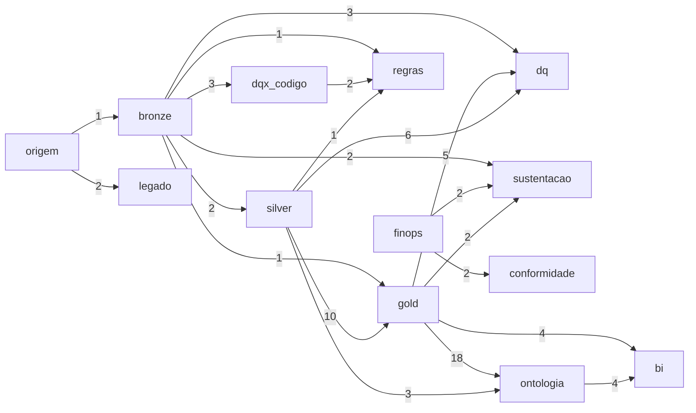

# Modelo de dados do pos_venda

> Gerado por `governanca/modelo_dados.py` (Unity Catalog: colunas, PK, FK e `system.access.table_lineage`). Não edite.
> Cada base tem o seu modelo de entidade e relacionamento, a lista de entidades com chave e a linhagem.

## Bases

| Base | Schemas | Papel | Entidades | Com chave | Relacionamentos |
|---|---|---|---|---|---|
| [origem](origem.md) | landing, fonte | principal | 2 | 2 | 1 |
| [bronze](bronze.md) | bronze | principal | 1 | 1 | 1 |
| [silver](silver.md) | silver | principal | 4 | 4 | 4 |
| [gold](gold.md) | gold | principal | 17 | 17 | 18 |
| [ontologia](ontologia.md) | ontologia | principal | 17 | 13 | 8 |
| [regras](regras.md) | regras | principal | 6 | 6 | 5 |
| [dq](dq.md) | dq | principal | 16 | 12 | 7 |
| [bi](bi.md) | bi | principal | 8 | 5 | 12 |
| [dqx_codigo](dqx_codigo.md) | dqx_codigo | apoio | 3 | 3 | 1 |
| [conformidade](conformidade.md) | conformidade | apoio | 15 | 12 | 9 |
| [finops](finops.md) | finops | apoio | 20 | 11 | 6 |
| [sustentacao](sustentacao.md) | sustentacao | apoio | 14 | 13 | 9 |
| [legado](legado.md) | bronze_sql, silver_sql, gold_sql, bronze_ldp, silver_ldp, gold_ldp | legado | 32 | 26 | 26 |

## Linhagem entre as bases

Número de ligações de tabela para tabela, de uma base para outra.

