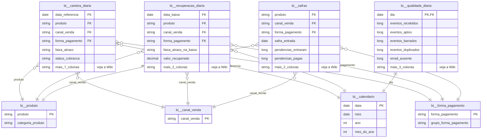

# Base bi · modelo de entidade e relacionamento

> Gerado por `governanca/modelo_dados.py` a partir do Unity Catalog. Não edite: rode `python3 governanca/modelo_dados.py gerar`.
> Schemas: `pos_venda.bi` · papel: **principal**.

Extratos para o Power BI, com paridade com o painel do Databricks (P23).

## Diagrama

Chave: `PK` (declarada no Unity Catalog ou lógica, ver a tabela abaixo) e `FK` (coluna que aponta para outra entidade).
Relacionamentos com outras bases aparecem com o nome completo da entidade (`schema__tabela`).

## Entidades

| Entidade | Tipo | Chave | Colunas | Descrição |
|---|---|---|---|---|
| `bi.calendario` | view | `data` (lógica) | 4 | Calendário contínuo dos anos com dados (dimensão de datas do Power BI). |
| `bi.canal_venda` | view | `canal_venda` (lógica) | 1 | Canais de venda (dimensão do Power BI). |
| `bi.carteira_diaria` | view | sem chave declarada | 13 | Carteira em aberto por dia, produto, canal, faixa, status, grupo do motivo e forma, calculada pela metric view mv_carteira_em_aberto. Saldos são SEMIADITIVOS: s |
| `bi.forma_pagamento` | view | `forma_pagamento` (lógica) | 2 | Formas de pagamento do catálogo e NAO_CADASTRADA (dado que vazou da barreira de qualidade). |
| `bi.produto` | view | `produto` (lógica) | 2 | Produtos de seguro de vida (dimensão do Power BI). |
| `bi.qualidade_diaria` | view | `dia` (lógica) | 9 | Qualidade diária dos eventos do sistema de origem, calculada pela metric view mv_qualidade_dados. |
| `bi.recuperacao_diaria` | view | sem chave declarada | 8 | Recuperação (baixas) por dia da baixa, produto, canal, forma e faixa de atraso na baixa, calculada pela metric view mv_recuperacao. Aditiva no tempo. |
| `bi.safras` | view | sem chave declarada | 8 | Safras de entrada por produto, canal e forma, calculadas pela metric view mv_safra_recuperacao. |

## Relacionamentos

| De | Para | Colunas | Cardinalidade | Tipo | O que significa |
|---|---|---|---|---|---|
| `bi.carteira_diaria` | `bi.produto` | produto → produto | N:1 | lógico | saldo do dia de um produto |
| `bi.carteira_diaria` | `bi.canal_venda` | canal_venda → canal_venda | N:1 | lógico | saldo do dia de um canal |
| `bi.recuperacao_diaria` | `bi.produto` | produto → produto | N:1 | lógico | recuperação de um produto |
| `bi.recuperacao_diaria` | `bi.canal_venda` | canal_venda → canal_venda | N:1 | lógico | recuperação de um canal |
| `bi.safras` | `bi.produto` | produto → produto | N:1 | lógico | safra de um produto |
| `bi.safras` | `bi.canal_venda` | canal_venda → canal_venda | N:1 | lógico | safra de um canal |
| `bi.carteira_diaria` | `bi.calendario` | data_referencia → data | N:1 | lógico | saldo de um dia do calendário |
| `bi.recuperacao_diaria` | `bi.calendario` | data_baixa → data | N:1 | lógico | recuperação de um dia |
| `bi.qualidade_diaria` | `bi.calendario` | dia → data | 1:1 | lógico | qualidade de um dia |
| `bi.carteira_diaria` | `bi.forma_pagamento` | forma_pagamento → forma_pagamento | N:1 | lógico | saldo de uma forma de pagamento |
| `bi.recuperacao_diaria` | `bi.forma_pagamento` | forma_pagamento → forma_pagamento | N:1 | lógico | recuperação de uma forma de pagamento |
| `bi.safras` | `bi.forma_pagamento` | forma_pagamento → forma_pagamento | N:1 | lógico | safra de uma forma de pagamento |

## Linhagem (Unity Catalog, últimos 90 dias)

| Entidade | Vem de | Alimenta |
|---|---|---|
| `bi.calendario` | `gold.dq_qualidade_diaria` | — |
| `bi.canal_venda` | `gold.dim_ponto_venda` | — |
| `bi.carteira_diaria` | `ontologia.mv_carteira_em_aberto` | — |
| `bi.forma_pagamento` | `gold.dim_forma_pagamento` | — |
| `bi.produto` | `gold.dim_produto` | — |
| `bi.qualidade_diaria` | `ontologia.mv_qualidade_dados` | — |
| `bi.recuperacao_diaria` | `ontologia.mv_recuperacao` | — |
| `bi.safras` | `ontologia.mv_safra_recuperacao` | — |
