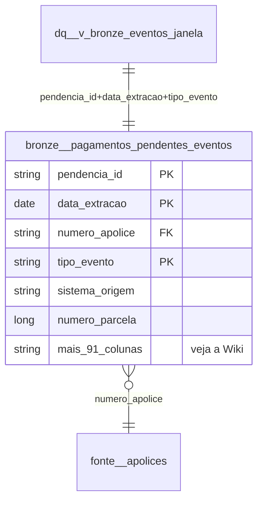

# Base bronze · modelo de entidade e relacionamento

> Gerado por `governanca/modelo_dados.py` a partir do Unity Catalog. Não edite: rode `python3 governanca/modelo_dados.py gerar`.
> Schemas: `pos_venda.bronze` · papel: **principal**.

Registro fiel do que a origem enviou, um evento por linha, append-only (P06).

## Diagrama

Chave: `PK` (declarada no Unity Catalog ou lógica, ver a tabela abaixo) e `FK` (coluna que aponta para outra entidade).
Relacionamentos com outras bases aparecem com o nome completo da entidade (`schema__tabela`).

## Entidades

| Entidade | Tipo | Chave | Colunas | Descrição |
|---|---|---|---|---|
| `bronze.pagamentos_pendentes_eventos` | managed | `pendencia_id`, `data_extracao`, `tipo_evento` (lógica; não única: 10.277 repetidas no ensaio de 24/11) | 97 | Bronze: eventos diarios de pendencias de pagamento (seguro de vida) recebidos do sistema de origem. Append-only. |

## Relacionamentos

| De | Para | Colunas | Cardinalidade | Tipo | O que significa |
|---|---|---|---|---|---|
| `bronze.pagamentos_pendentes_eventos` | `fonte.apolices` | numero_apolice → numero_apolice | N:1 | lógico | o evento é de uma apólice do cadastro |
| `dq.v_bronze_eventos_janela` | `bronze.pagamentos_pendentes_eventos` | pendencia_id, data_extracao, tipo_evento → pendencia_id, data_extracao, tipo_evento | 1:1 | lógico | janela do bronze |

## Linhagem (Unity Catalog, últimos 90 dias)

| Entidade | Vem de | Alimenta |
|---|---|---|
| `bronze.pagamentos_pendentes_eventos` | `fonte.apolices` | `dq.janela_avaliacao`, `dq.v_bronze_eventos_7d`, `dq.v_bronze_eventos_janela`, `dqx_codigo.dq_metricas_regras`, `dqx_codigo.eventos_quarentena`, `dqx_codigo.eventos_validos`, `gold.dq_qualidade_diaria`, `regras.v_falhas_regras` … |
