# Base conformidade · modelo de entidade e relacionamento

> Gerado por `governanca/modelo_dados.py` a partir do Unity Catalog. Não edite: rode `python3 governanca/modelo_dados.py gerar`.
> Schemas: `pos_venda.conformidade` · papel: **apoio**.

Conformidade dos dados e do workspace: regras, achados, histórico e sonda das views (P35 a P37).

## Diagrama

Chave: `PK` (declarada no Unity Catalog ou lógica, ver a tabela abaixo) e `FK` (coluna que aponta para outra entidade).
Relacionamentos com outras bases aparecem com o nome completo da entidade (`schema__tabela`).

```mermaid
erDiagram
  conformidade__achados {
    string regra_id FK
    string catalogo FK
    string esquema FK
    string ativo FK
    string dimensao
    string regra
    string mais_7_colunas "veja a Wiki"
  }
  conformidade__acoes_observabilidade {
    string acao PK
    string tipo
    string o_que_faz
    string achado
    string veredito
    string motivo
    string mais_7_colunas "veja a Wiki"
  }
  conformidade__ativos {
    string catalogo PK
    string esquema PK,FK
    string ativo PK
    string tipo
    string papel
    string camada
    string mais_20_colunas "veja a Wiki"
  }
  conformidade__boas_praticas_dados {
    string regra_id PK,FK
    string dimensao
    string regra
    string escopo
    string severidade
    long aplicavel
    string mais_8_colunas "veja a Wiki"
  }
  conformidade__colunas {
    string esquema PK,FK
    string ativo PK,FK
    string coluna PK
    string tipo_ativo
    string papel
    string camada
    string mais_7_colunas "veja a Wiki"
  }
  conformidade__config_camadas {
    string esquema PK
    string camada
    string papel
  }
  conformidade__config_regras {
    string regra_id PK
    string dimensao
    string regra
    string objeto
    string escopo
    double meta_pct
    string mais_4_colunas "veja a Wiki"
  }
  conformidade__config_tags_governadas {
    string tag PK
    array valores
    string descricao
  }
  conformidade__historico {
    date registrado_em PK
    string regra_id PK,FK
    string dimensao
    string regra
    long aplicavel
    long conformes
    string mais_4_colunas "veja a Wiki"
  }
  conformidade__mv_conformidade {
    string Regra
    string Descri__o_da_regra
    string Dimens_o
    string Severidade
    string Tipo_de_objeto
    string Cat_logo
    string mais_6_colunas "veja a Wiki"
  }
  conformidade__pendencias {
    string regra_id FK
    string severidade
    string dimensao
    string regra
    string objeto
    string catalogo
    string mais_6_colunas "veja a Wiki"
  }
  conformidade__plataforma_por_catalogo {
    string catalogo PK
    string dimensao PK
    long verificacoes
    long conformes
    long falhas
    decimal pct_conforme
  }
  conformidade__recursos {
    string recurso_id PK
    string tipo_recurso
    string nome
    map tags
    string projeto
    string time
    string mais_7_colunas "veja a Wiki"
  }
  conformidade__sonda_views {
    timestamp sondado_em PK
    string catalogo PK,FK
    string esquema PK,FK
    string ativo PK,FK
    string tipo
    boolean responde
    string mais_1_colunas "veja a Wiki"
  }
  conformidade__squad_por_schema {
    string esquema PK,FK
    string dimensao PK
    string papel
    long verificacoes
    long conformes
    long falhas
    string mais_1_colunas "veja a Wiki"
  }
  conformidade__achados }o--|| conformidade__config_regras : "regra_id"
  conformidade__achados }o--o| conformidade__ativos : "catalogo+esquema+ativo"
  conformidade__pendencias }o--|| conformidade__config_regras : "regra_id"
  conformidade__historico }o--|| conformidade__config_regras : "regra_id"
  conformidade__boas_praticas_dados ||--|| conformidade__config_regras : "regra_id"
  conformidade__sonda_views }o--|| conformidade__ativos : "catalogo+esquema+ativo"
  conformidade__colunas }o--|| conformidade__ativos : "esquema+ativo"
  conformidade__squad_por_schema }o--|| conformidade__config_camadas : "esquema"
  conformidade__ativos }o--o| conformidade__config_camadas : "esquema"
```

## Entidades

| Entidade | Tipo | Chave | Colunas | Descrição |
|---|---|---|---|---|
| `conformidade.achados` | view | sem chave declarada | 13 | Uma linha por verificação (objeto × regra): conforme ou não, com o detalhe e como corrigir. Base de pendencias, boas_praticas_dados, squad_por_schema, plataform |
| `conformidade.acoes_observabilidade` | view | `acao` (lógica) | 13 | Avaliação das ações de observabilidade que já rodam no workspace (bundle observabilidade-framework e finops.observability): o que fazem, o que se encontrou, ver |
| `conformidade.ativos` | view | `catalogo`, `esquema`, `ativo` (lógica) | 26 | Inventário de tabelas e views do workspace (menos system e samples) com o que a conformidade mede: descrição, colunas sem descrição, tags, dado pessoal, chave p |
| `conformidade.boas_praticas_dados` | view | `regra_id` (lógica) | 14 | Uma linha por regra: objetos verificados, conformes, falhas, porcentagem, meta e situação, com origem e como corrigir. Regra sem objeto verificado fica 'sem dad |
| `conformidade.colunas` | view | `esquema`, `ativo`, `coluna` (lógica) | 13 | Colunas do catálogo pos_venda com descrição, tag dado_pessoal, classes da classificação automática (class.*) e se o nome indica dado pessoal. |
| `conformidade.config_camadas` | view | `esquema` (lógica) | 3 | Papel de cada schema do catálogo pos_venda: principal (fluxo diário), legado (medalhão da primeira versão) ou apoio (monitoramento). Editado em conformidade/ger |
| `conformidade.config_regras` | view | `regra_id` (lógica) | 10 | Catálogo de regras de conformidade: dimensão, meta, severidade, origem, link da fonte e como corrigir. Editado em conformidade/gerar_conformidade.py. |
| `conformidade.config_tags_governadas` | view | `tag` (lógica) | 3 | Tags governadas com valores permitidos (tag policies do workspace), lidas pela API em conformidade/politicas_tags.json. |
| `conformidade.historico` | managed | `registrado_em`, `regra_id` (lógica) | 10 | Histórico diário de boas_praticas_dados (uma linha por regra e dia). Gravado por gerar_conformidade.py registrar. |
| `conformidade.mv_conformidade` | metric view | sem chave declarada | 12 | Conformidade dos dados e do workspace: uma verificação por objeto e regra. Use Conformidade (%) por dimensão, schema ou regra; Pendências conta o que falta corr |
| `conformidade.pendencias` | view | sem chave declarada | 12 | Só as verificações que não atendem: a lista de correções, com severidade e como corrigir. |
| `conformidade.plataforma_por_catalogo` | view | `catalogo`, `dimensao` (lógica) | 6 | Visão da plataforma: conformidade de cada catálogo do workspace e dos recursos (jobs e warehouses) por dimensão. |
| `conformidade.recursos` | view | `recurso_id` (lógica) | 13 | Jobs e warehouses ativos do workspace (versão mais recente em system.lakeflow.jobs e system.compute.warehouses) com tags, descrição, timeout, agenda e auto-stop |
| `conformidade.sonda_views` | managed | `sondado_em`, `catalogo`, `esquema`, `ativo` (lógica) | 7 | Resultado da sonda diária: cada view, metric view e materialized view do workspace testada com DESCRIBE QUERY (analisa sem executar). Gravado por gerar_conformi |
| `conformidade.squad_por_schema` | view | `esquema`, `dimensao` (lógica) | 7 | Visão do squad: conformidade de cada schema do catálogo pos_venda por dimensão. |

## Relacionamentos

| De | Para | Colunas | Cardinalidade | Tipo | O que significa |
|---|---|---|---|---|---|
| `conformidade.achados` | `conformidade.config_regras` | regra_id → regra_id | N:1 | lógico | cada verificação é de uma regra |
| `conformidade.achados` | `conformidade.ativos` | catalogo, esquema, ativo → catalogo, esquema, ativo | N:0..1 | lógico | a verificação é sobre um ativo (ou job, warehouse, alerta) |
| `conformidade.pendencias` | `conformidade.config_regras` | regra_id → regra_id | N:1 | lógico | pendência de uma regra |
| `conformidade.historico` | `conformidade.config_regras` | regra_id → regra_id | N:1 | lógico | foto diária de uma regra |
| `conformidade.boas_praticas_dados` | `conformidade.config_regras` | regra_id → regra_id | 1:1 | lógico | situação atual da regra |
| `conformidade.sonda_views` | `conformidade.ativos` | catalogo, esquema, ativo → catalogo, esquema, ativo | N:1 | lógico | sonda diária de uma view |
| `conformidade.colunas` | `conformidade.ativos` | esquema, ativo → esquema, ativo | N:1 | lógico | coluna de um ativo do pos_venda |
| `conformidade.squad_por_schema` | `conformidade.config_camadas` | esquema → esquema | N:1 | lógico | conformidade de um schema com papel |
| `conformidade.ativos` | `conformidade.config_camadas` | esquema → esquema | N:0..1 | lógico | papel do schema (só os do pos_venda) |

## Linhagem (Unity Catalog, últimos 90 dias)

| Entidade | Vem de | Alimenta |
|---|---|---|
| `conformidade.achados` | `conformidade.ativos`, `conformidade.colunas`, `conformidade.config_camadas`, `conformidade.config_regras`, `conformidade.config_tags_governadas`, `conformidade.recursos`, `conformidade.sonda_views` | `conformidade.boas_praticas_dados`, `conformidade.mv_conformidade`, `conformidade.pendencias`, `conformidade.plataforma_por_catalogo`, `conformidade.squad_por_schema` |
| `conformidade.acoes_observabilidade` | `conformidade.recursos`, `conformidade.sonda_views`, `finops.custo_sql_por_consulta`, `finops.uso_jobs_diario` | — |
| `conformidade.ativos` | `conformidade.config_camadas` | `conformidade.achados` |
| `conformidade.boas_praticas_dados` | `conformidade.achados`, `conformidade.config_regras` | `conformidade.historico` |
| `conformidade.colunas` | `conformidade.config_camadas` | `conformidade.achados` |
| `conformidade.config_camadas` | — | `conformidade.achados`, `conformidade.ativos`, `conformidade.colunas` |
| `conformidade.config_regras` | — | `conformidade.achados`, `conformidade.boas_praticas_dados` |
| `conformidade.config_tags_governadas` | — | `conformidade.achados` |
| `conformidade.historico` | `conformidade.boas_praticas_dados` | — |
| `conformidade.mv_conformidade` | `conformidade.achados` | — |
| `conformidade.pendencias` | `conformidade.achados` | — |
| `conformidade.plataforma_por_catalogo` | `conformidade.achados` | — |
| `conformidade.recursos` | — | `conformidade.achados`, `conformidade.acoes_observabilidade` |
| `conformidade.sonda_views` | — | `conformidade.achados`, `conformidade.acoes_observabilidade` |
| `conformidade.squad_por_schema` | `conformidade.achados` | — |
