# Base dq · modelo de entidade e relacionamento

> Gerado por `governanca/modelo_dados.py` a partir do Unity Catalog. Não edite: rode `python3 governanca/modelo_dados.py gerar`.
> Schemas: `pos_venda.dq` · papel: **principal**.

Janelas de avaliação do DQX Studio e visões do painel de qualidade (P11, P12).

## Diagrama

Chave: `PK` (declarada no Unity Catalog ou lógica, ver a tabela abaixo) e `FK` (coluna que aponta para outra entidade).
Relacionamentos com outras bases aparecem com o nome completo da entidade (`schema__tabela`).

```mermaid
erDiagram
  dq__janela_avaliacao {
    string origem PK
    date data_inicio
    date data_fim
    timestamp atualizado_em
  }
  dq__v_bronze_eventos_7d {
    string pendencia_id PK
    date data_extracao PK
    string tipo_evento PK
    string sistema_origem
    string numero_apolice
    long numero_parcela
    string mais_91_colunas "veja a Wiki"
  }
  dq__v_bronze_eventos_janela {
    string pendencia_id PK,FK
    date data_extracao PK,FK
    string tipo_evento PK,FK
    string sistema_origem
    string numero_apolice
    long numero_parcela
    string mais_91_colunas "veja a Wiki"
  }
  dq__v_fato_snapshot_7d {
    int data_referencia_sk PK
    string pendencia_id PK
    string numero_apolice
    int numero_parcela
    long cliente_sk
    long apolice_sk
    string mais_22_colunas "veja a Wiki"
  }
  dq__v_fato_snapshot_janela {
    int data_referencia_sk PK,FK
    string pendencia_id PK,FK
    string numero_apolice
    int numero_parcela
    long cliente_sk
    long apolice_sk
    string mais_22_colunas "veja a Wiki"
  }
  dq__v_painel_barrados {
    date dia PK
    string motivo_rejeicao PK,FK
    string tipo_evento PK
    int semana_n
    string semana
    long eventos
    string mais_2_colunas "veja a Wiki"
  }
  dq__v_painel_diario {
    date dia PK
    int semana_n
    string semana
    long eventos_recebidos
    long eventos_aptos
    long eventos_barrados
    string mais_13_colunas "veja a Wiki"
  }
  dq__v_painel_quarentena {
    date dia
    int semana_n
    string semana
    string motivo_rejeicao
    string pendencia_id
    string tipo_evento
    string mais_20_colunas "veja a Wiki"
  }
  dq__v_painel_studio_execucoes {
    string run_id PK
    int semana_n
    string semana
    string camada
    string camada_curta
    string destino
    string mais_7_colunas "veja a Wiki"
  }
  dq__v_painel_studio_regras {
    string run_id PK,FK
    string regra PK
    int semana_n
    string semana
    string camada
    string camada_curta
    string mais_5_colunas "veja a Wiki"
  }
  dq__v_painel_studio_reprovadas {
    int semana_n
    string semana
    string camada
    string camada_curta
    string regra
    string mensagem
    string mais_6_colunas "veja a Wiki"
  }
  dq__v_quarentena_janela {
    string pendencia_id PK,FK
    date data_extracao PK,FK
    string tipo_evento PK,FK
    string sistema_origem
    string numero_apolice
    long numero_parcela
    string mais_93_colunas "veja a Wiki"
  }
  dq__v_silver_eventos_aptos_janela {
    string pendencia_id PK,FK
    date data_extracao PK,FK
    string tipo_evento PK,FK
    string sistema_origem
    string numero_apolice
    long numero_parcela
    string mais_97_colunas "veja a Wiki"
  }
  dq__v_silver_hist_janela {
    string pendencia_id
    date data_extracao
    string sistema_origem
    string numero_apolice
    long numero_parcela
    string competencia
    string mais_99_colunas "veja a Wiki"
  }
  dq__v_silver_pendencia_atual_7d {
    string pendencia_id PK,FK
    date data_extracao
    string sistema_origem
    string numero_apolice
    long numero_parcela
    string competencia
    string mais_97_colunas "veja a Wiki"
  }
  dq__v_silver_pendencia_hist_7d {
    string pendencia_id
    date data_extracao
    string sistema_origem
    string numero_apolice
    long numero_parcela
    string competencia
    string mais_99_colunas "veja a Wiki"
  }
  dq__v_bronze_eventos_janela ||--|| bronze__pagamentos_pendentes_eventos : "pendencia_id+data_extracao+tipo_evento"
  dq__v_quarentena_janela ||--|| silver__pendencia_evento_quarentena : "pendencia_id+data_extracao+tipo_evento"
  dq__v_silver_eventos_aptos_janela ||--|| silver__pendencia_evento : "pendencia_id+data_extracao+tipo_evento"
  dq__v_silver_pendencia_atual_7d ||--|| silver__pendencia_atual : "pendencia_id"
  dq__v_fato_snapshot_janela ||--|| gold__fact_pagamento_pendente_snapshot : "pendencia_id+data_referencia_sk"
  dq__v_painel_studio_regras }o--|| dq__v_painel_studio_execucoes : "run_id"
  dq__v_painel_barrados }o--|| regras__catalogo_regras : "motivo_rejeicao"
```

## Entidades

| Entidade | Tipo | Chave | Colunas | Descrição |
|---|---|---|---|---|
| `dq.janela_avaliacao` | managed | `origem` (lógica) | 4 | Janela de avaliacao do DQX Studio: intervalo de dias que as views pos_venda.dq.v_*_janela expoem. |
| `dq.v_bronze_eventos_7d` | view | `pendencia_id`, `data_extracao`, `tipo_evento` (lógica; janela de 7 dias do bronze; repete como o bronze) | 97 | Bronze: eventos dos ultimos 7 dias carregados (janela usada pelo DQX Studio). |
| `dq.v_bronze_eventos_janela` | view | `pendencia_id`, `data_extracao`, `tipo_evento` (lógica; janela do bronze; repete como o bronze) | 97 | Bronze: todos os eventos recebidos na janela de avaliacao (aptos e nao aptos). |
| `dq.v_fato_snapshot_7d` | view | `pendencia_id`, `data_referencia_sk` (lógica) | 28 | Gold (fato historica): fotos diarias dos ultimos 7 dias. |
| `dq.v_fato_snapshot_janela` | view | `pendencia_id`, `data_referencia_sk` (lógica) | 28 | Gold (fato historica): fotos diarias da janela de avaliacao. |
| `dq.v_painel_barrados` | view | `dia`, `motivo_rejeicao`, `tipo_evento` (lógica) | 8 | Painel de qualidade: eventos barrados na silver por dia, motivo da rejeição e tipo de evento, com a semana da simulação. |
| `dq.v_painel_diario` | view | `dia` (lógica) | 19 | Painel de qualidade: métricas diárias (recebidos, barrados, avisos) e linhas órfãs da fato, com a semana da simulação. |
| `dq.v_painel_quarentena` | view | sem chave declarada | 26 | Painel de qualidade: eventos barrados antes da silver (quarentena), com o motivo e os dados do cliente. |
| `dq.v_painel_studio_execucoes` | view | `run_id` (lógica) | 13 | Painel de qualidade: execuções do DQX Studio com todas as linhas, uma por semana e por camada. |
| `dq.v_painel_studio_regras` | view | `run_id`, `regra` (lógica) | 11 | Painel de qualidade: regras violadas por semana e camada nas execuções completas do DQX Studio. |
| `dq.v_painel_studio_reprovadas` | view | sem chave declarada | 12 | Painel de qualidade: linhas que o DQX Studio reprovou (regra de erro) nas execuções completas, com a regra e a mensagem. |
| `dq.v_quarentena_janela` | view | `pendencia_id`, `data_extracao`, `tipo_evento` (lógica; não única: a origem reenvia eventos idênticos; duplicata é aviso (dq_qualidade_diaria.eventos_duplicados)) | 99 | Quarentena: eventos NAO aptos barrados antes da silver na janela de avaliacao, com o motivo da rejeicao. |
| `dq.v_silver_eventos_aptos_janela` | view | `pendencia_id`, `data_extracao`, `tipo_evento` (lógica; não única: a origem reenvia eventos idênticos; duplicata é aviso (dq_qualidade_diaria.eventos_duplicados)) | 103 | Silver: eventos que passaram na barreira de qualidade e entraram na silver na janela de avaliacao. |
| `dq.v_silver_hist_janela` | view | sem chave declarada | 105 | Silver historica (SCD2): versoes iniciadas na janela de avaliacao. |
| `dq.v_silver_pendencia_atual_7d` | view | `pendencia_id` (lógica) | 103 | Silver (estado atual): pendencias com evento nos ultimos 7 dias. |
| `dq.v_silver_pendencia_hist_7d` | view | sem chave declarada | 105 | Silver historica (SCD2): versoes iniciadas nos ultimos 7 dias. |

## Relacionamentos

| De | Para | Colunas | Cardinalidade | Tipo | O que significa |
|---|---|---|---|---|---|
| `dq.v_bronze_eventos_janela` | `bronze.pagamentos_pendentes_eventos` | pendencia_id, data_extracao, tipo_evento → pendencia_id, data_extracao, tipo_evento | 1:1 | lógico | janela do bronze |
| `dq.v_quarentena_janela` | `silver.pendencia_evento_quarentena` | pendencia_id, data_extracao, tipo_evento → pendencia_id, data_extracao, tipo_evento | 1:1 | lógico | janela da quarentena |
| `dq.v_silver_eventos_aptos_janela` | `silver.pendencia_evento` | pendencia_id, data_extracao, tipo_evento → pendencia_id, data_extracao, tipo_evento | 1:1 | lógico | janela dos eventos aptos |
| `dq.v_silver_pendencia_atual_7d` | `silver.pendencia_atual` | pendencia_id → pendencia_id | 1:1 | lógico | janela da foto atual |
| `dq.v_fato_snapshot_janela` | `gold.fact_pagamento_pendente_snapshot` | pendencia_id, data_referencia_sk → pendencia_id, data_referencia_sk | 1:1 | lógico | janela da fato |
| `dq.v_painel_studio_regras` | `dq.v_painel_studio_execucoes` | run_id → run_id | N:1 | lógico | regras de uma execução do Studio |
| `dq.v_painel_barrados` | `regras.catalogo_regras` | motivo_rejeicao → regra_id | N:1 | lógico | barrados por uma regra de erro |

## Linhagem (Unity Catalog, últimos 90 dias)

| Entidade | Vem de | Alimenta |
|---|---|---|
| `dq.janela_avaliacao` | `bronze.pagamentos_pendentes_eventos` | `dq._teste_preservacao_v` |
| `dq.v_bronze_eventos_7d` | `bronze.pagamentos_pendentes_eventos` | — |
| `dq.v_bronze_eventos_janela` | `bronze.pagamentos_pendentes_eventos` | — |
| `dq.v_fato_snapshot_7d` | `gold.fact_pagamento_pendente_snapshot` | — |
| `dq.v_fato_snapshot_janela` | `gold.fact_pagamento_pendente_snapshot` | — |
| `dq.v_painel_barrados` | `gold.dq_barrados_por_motivo_dia` | — |
| `dq.v_painel_diario` | `gold.dq_fato_orfas_diarias`, `gold.dq_qualidade_diaria` | — |
| `dq.v_painel_quarentena` | `silver.pendencia_evento_quarentena` | — |
| `dq.v_painel_studio_execucoes` | — | `dq.v_painel_studio_regras`, `dq.v_painel_studio_reprovadas` |
| `dq.v_painel_studio_regras` | `dq.v_painel_studio_execucoes` | — |
| `dq.v_painel_studio_reprovadas` | `dq.v_painel_studio_execucoes` | — |
| `dq.v_quarentena_janela` | `silver.pendencia_evento_quarentena` | — |
| `dq.v_silver_eventos_aptos_janela` | `silver.pendencia_evento` | — |
| `dq.v_silver_hist_janela` | `silver.pendencia_hist` | — |
| `dq.v_silver_pendencia_atual_7d` | `silver.pendencia_atual` | — |
| `dq.v_silver_pendencia_hist_7d` | `silver.pendencia_hist` | — |
