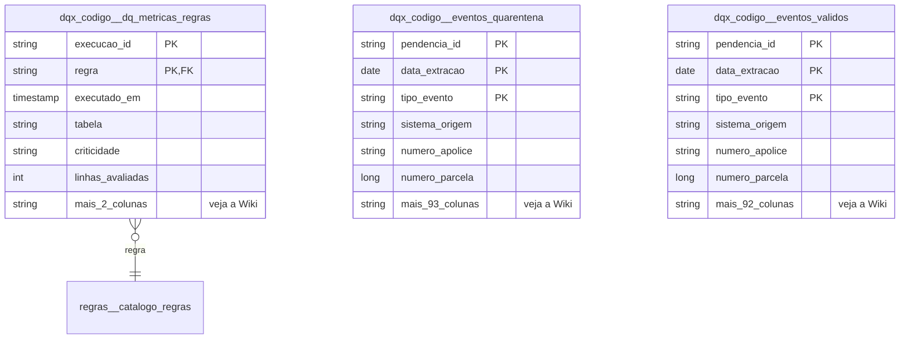

# Base dqx_codigo · modelo de entidade e relacionamento

> Gerado por `governanca/modelo_dados.py` a partir do Unity Catalog. Não edite: rode `python3 governanca/modelo_dados.py gerar`.
> Schemas: `pos_venda.dqx_codigo` · papel: **apoio**.

Resultado do DQX como código (trilha A): válidos, quarentena e métricas por regra e versão (P38, P41).

## Diagrama

Chave: `PK` (declarada no Unity Catalog ou lógica, ver a tabela abaixo) e `FK` (coluna que aponta para outra entidade).
Relacionamentos com outras bases aparecem com o nome completo da entidade (`schema__tabela`).

## Entidades

| Entidade | Tipo | Chave | Colunas | Descrição |
|---|---|---|---|---|
| `dqx_codigo.dq_metricas_regras` | managed | `execucao_id`, `regra` (lógica; a coluna versao entra na próxima execução gravada (mergeSchema)) | 8 | Histórico do DQX como código: uma linha por execução e regra, com linhas avaliadas, reprovadas e taxa. Base do painel de qualidade e do plano de ação. |
| `dqx_codigo.eventos_quarentena` | managed | `pendencia_id`, `data_extracao`, `tipo_evento` (lógica; não única: a origem reenvia eventos idênticos; duplicata é aviso (dq_qualidade_diaria.eventos_duplicados)) | 99 | Linhas de pos_venda.bronze.pagamentos_pendentes_eventos com ao menos um erro nas checagens do DQX como código; cada regra violada em _errors. Gerada por dqx_cod |
| `dqx_codigo.eventos_validos` | managed | `pendencia_id`, `data_extracao`, `tipo_evento` (lógica; não única: a origem reenvia eventos idênticos; duplicata é aviso (dq_qualidade_diaria.eventos_duplicados)) | 98 | Linhas de pos_venda.bronze.pagamentos_pendentes_eventos sem erro nas checagens do DQX como código; avisos na coluna _warnings. Gerada por dqx_codigo/aplicar_dqx |

## Relacionamentos

| De | Para | Colunas | Cardinalidade | Tipo | O que significa |
|---|---|---|---|---|---|
| `dqx_codigo.dq_metricas_regras` | `regras.catalogo_regras` | regra → regra_id | N:1 | lógico | métrica de uma regra do catálogo |

## Linhagem (Unity Catalog, últimos 90 dias)

| Entidade | Vem de | Alimenta |
|---|---|---|
| `dqx_codigo.dq_metricas_regras` | `bronze.pagamentos_pendentes_eventos` | — |
| `dqx_codigo.eventos_quarentena` | `bronze.pagamentos_pendentes_eventos` | `regras.v_falhas_regras` |
| `dqx_codigo.eventos_validos` | `bronze.pagamentos_pendentes_eventos` | `regras.v_falhas_regras` |
