# Base finops · modelo de entidade e relacionamento

> Gerado por `governanca/modelo_dados.py` a partir do Unity Catalog. Não edite: rode `python3 governanca/modelo_dados.py gerar`.
> Schemas: `pos_venda.finops` · papel: **apoio**.

Custo e uso no padrão FOCUS, por projeto, funcionalidade e squad (P30 a P34).

## Diagrama

Chave: `PK` (declarada no Unity Catalog ou lógica, ver a tabela abaixo) e `FK` (coluna que aponta para outra entidade).
Relacionamentos com outras bases aparecem com o nome completo da entidade (`schema__tabela`).

```mermaid
erDiagram
  finops__boas_praticas_custo {
    string codigo PK
    string pratica
    string fonte
    string publico
    string metrica
    double valor
    string mais_4_colunas "veja a Wiki"
  }
  finops__config_ativos {
    string id PK
    string tipo
    string nome
  }
  finops__config_atribuicao {
    int ordem PK
    string tipo_recurso
    string padrao
    string projeto
    string time
    string tipo_time
  }
  finops__config_custo {
    string moeda_cobranca
    decimal cambio_usd_brl
    date data_cambio
    decimal desconto_global_pct
    string modo_preco
    string plano
    string mais_2_colunas "veja a Wiki"
  }
  finops__custo_por_funcionalidade {
    date mes
    string categoria_focus
    string subcategoria_focus
    string produto
    string funcionalidade
    boolean serverless
    string mais_8_colunas "veja a Wiki"
  }
  finops__custo_por_projeto_diario {
    string projeto FK
    date dia
    string time
    string tipo_time
    string funcionalidade
    string origem_atribuicao
    string mais_3_colunas "veja a Wiki"
  }
  finops__custo_sql_por_consulta {
    timestamp hora PK
    string statement_id PK
    string warehouse_id
    string origem
    string projeto
    string time
    string mais_9_colunas "veja a Wiki"
  }
  finops__focus_custo_uso {
    string AllocatedMethodId
    string AllocatedMethodDetails
    string AllocatedResourceId
    string AllocatedResourceName
    string AllocatedTags
    string AvailabilityZone
    string mais_77_colunas "veja a Wiki"
  }
  finops__mv_finops_custo {
    date M_s
    date Dia
    string Funcionalidade
    string Categoria_FOCUS
    string Produto
    string Projeto
    string mais_12_colunas "veja a Wiki"
  }
  finops__plataforma_atribuicao_mensal {
    date mes
    string origem_atribuicao
    string tipo_time
    decimal custo_lista_usd
    decimal pct_do_mes
    long recursos
  }
  finops__plataforma_custo_diario {
    date dia PK
    string funcionalidade PK
    decimal custo_lista_usd
    decimal custo_lista_brl
    decimal media_7d_usd
    decimal variacao_vs_media_pct
    string mais_1_colunas "veja a Wiki"
  }
  finops__plataforma_top_recursos {
    int posicao PK
    string tipo_recurso
    string recurso
    string funcionalidade
    string projeto
    string time
    string mais_5_colunas "veja a Wiki"
  }
  finops__plataforma_warehouses {
    string warehouse_id PK
    string warehouse
    string tipo_warehouse
    string tamanho
    int min_clusters
    int max_clusters
    string mais_6_colunas "veja a Wiki"
  }
  finops__squad_custo_mensal {
    string projeto FK
    date mes
    string time
    string funcionalidade
    decimal custo_lista_usd
    decimal custo_lista_brl
    string mais_3_colunas "veja a Wiki"
  }
  finops__squad_custo_unitario {
    date mes PK
    string projeto PK,FK
    string indicador PK
    decimal custo_lista_usd
    long quantidade
    string unidade
    string mais_1_colunas "veja a Wiki"
  }
  finops__squad_uso_diario {
    date dia PK
    string projeto PK,FK
    string indicador PK
    string time
    double valor
  }
  finops__uso_consultas_diario {
    date dia
    string origem
    string projeto
    string time
    string tipo_time
    long execucoes
    string mais_7_colunas "veja a Wiki"
  }
  finops__uso_genie_diario {
    date dia
    string espaco_id
    string espaco
    string projeto
    string time
    string tipo_time
    string mais_7_colunas "veja a Wiki"
  }
  finops__uso_jobs_diario {
    date dia PK
    string job PK
    string projeto FK
    string job_id
    string time
    string tipo_time
    string mais_7_colunas "veja a Wiki"
  }
  finops__uso_paineis_diario {
    date dia PK
    string painel_id PK
    string projeto FK
    string painel
    string time
    string tipo_time
    string mais_4_colunas "veja a Wiki"
  }
  finops__squad_custo_mensal }o--o{ finops__config_atribuicao : "projeto"
  finops__squad_custo_unitario }o--o{ finops__config_atribuicao : "projeto"
  finops__squad_uso_diario }o--o{ finops__config_atribuicao : "projeto"
  finops__custo_por_projeto_diario }o--o{ finops__config_atribuicao : "projeto"
  finops__uso_jobs_diario }o--o{ finops__config_atribuicao : "projeto"
  finops__uso_paineis_diario }o--o{ finops__config_atribuicao : "projeto"
```

## Entidades

| Entidade | Tipo | Chave | Colunas | Descrição |
|---|---|---|---|---|
| `finops.boas_praticas_custo` | view | `codigo` (lógica) | 10 | Boas práticas de custo medidas nos últimos 30 dias: pilar de custo do Well-Architected da Databricks (databricks-waf), powerbi-analyzer, dbx-adoption-monitor e  |
| `finops.config_ativos` | view | `id` (lógica) | 3 | Nomes de painéis, espaços Genie, projetos Lakebase e alertas SQL (foto da API em 2026-11-23, por `gerar_finops.py ativos`). |
| `finops.config_atribuicao` | view | `ordem` (lógica) | 6 | Regras de atribuição de custo e uso a projeto e time (editar em finops/gerar_finops.py, lista REGRAS). A primeira regra que casar vale. |
| `finops.config_custo` | view | sem chave declarada | 8 | Parâmetros de custo do FinOps: moeda, câmbio, desconto e plano. Lê finops.observability.v_focus_price_config (só leitura). |
| `finops.custo_por_funcionalidade` | view | sem chave declarada | 14 | Custo por funcionalidade do Databricks por mês, com a categoria FOCUS, serverless e a participação no mês. |
| `finops.custo_por_projeto_diario` | view | sem chave declarada | 9 | Custo por dia, projeto, time e funcionalidade. O SQL warehouse entra rateado por consulta; o resto vem direto da base FOCUS. A soma bate com focus_custo_uso. |
| `finops.custo_sql_por_consulta` | view | `statement_id`, `hora` (lógica) | 15 | Custo do SQL warehouse rateado por consulta: o custo de cada hora é dividido pelas consultas da hora, na proporção do tempo de trabalho (padrão do dbx-adoption- |
| `finops.focus_custo_uso` | view | sem chave declarada | 83 | Dataset FOCUS 1.4 Cost and Usage do workspace (system.billing.usage × list_prices), com colunas x_ de funcionalidade, projeto, time e reais. Base de todas as vi |
| `finops.mv_finops_custo` | metric view | sem chave declarada | 18 | Custo do workspace no padrão FOCUS 1.4. Use Custo de lista (USD ou BRL) para comparar: no Free Edition o custo faturado é 0. Quantidade consumida mistura unidad |
| `finops.plataforma_atribuicao_mensal` | view | sem chave declarada | 6 | Time de plataforma: quanto do custo de cada mês tem dono (tag, regra), é compartilhado ou não tem regra. Mede a prática WAF CO-03-01 (tags para atribuição). |
| `finops.plataforma_custo_diario` | view | `dia`, `funcionalidade` (lógica) | 7 | Time de plataforma: custo diário por funcionalidade, com a média dos 7 dias anteriores e a marcação de anomalia. |
| `finops.plataforma_top_recursos` | view | `posicao` (lógica) | 11 | Time de plataforma: recursos que mais custaram nos últimos 30 dias, com projeto e time. O SQL warehouse aparece como compartilhado; o rateio dele por consulta e |
| `finops.plataforma_warehouses` | view | `warehouse_id` (lógica) | 12 | Time de plataforma: configuração atual de cada SQL warehouse com custo, consultas, fila e ociosidade dos últimos 30 dias (práticas WAF CO-02-02 e powerbi-analyz |
| `finops.squad_custo_mensal` | view | sem chave declarada | 9 | Time de squad: custo mensal de cada projeto por funcionalidade, participação no projeto e variação sobre o mês anterior. |
| `finops.squad_custo_unitario` | view | `mes`, `projeto`, `indicador` (lógica) | 7 | Time de squad: custo unitário por mês e projeto (por execução de job, consulta SQL, visualização de painel, pergunta à Genie e dia de app). |
| `finops.squad_uso_diario` | view | `dia`, `projeto`, `indicador` (lógica) | 5 | Time de squad: uso diário dos ativos de cada projeto em formato longo (painéis, Genie por canal, consultas, execuções de job). |
| `finops.uso_consultas_diario` | view | sem chave declarada | 13 | Consultas SQL por dia, origem e projeto: execuções, falhas, duração, fila e custo rateado (a partir de custo_sql_por_consulta). |
| `finops.uso_genie_diario` | view | sem chave declarada | 13 | Uso da Genie por dia, espaço e canal: perguntas, leituras, aberturas e usuários (audit) com os DBUs e o custo (base FOCUS). Separa pessoas (UI) de automação e a |
| `finops.uso_jobs_diario` | view | `dia`, `job` (lógica) | 13 | Execuções de job por dia: sucessos, falhas, duração e custo (system.lakeflow.job_run_timeline × base FOCUS), com o custo das execuções com falha. |
| `finops.uso_paineis_diario` | view | `dia`, `painel_id` (lógica) | 10 | Uso dos painéis AI/BI por dia (system.access.audit): aberturas da versão publicada e do rascunho, consultas e usuários distintos. Padrão do dbx-adoption-monitor |

## Relacionamentos

| De | Para | Colunas | Cardinalidade | Tipo | O que significa |
|---|---|---|---|---|---|
| `finops.squad_custo_mensal` | `finops.config_atribuicao` | projeto → projeto | N:N | lógico | o projeto vem das regras de atribuição |
| `finops.squad_custo_unitario` | `finops.config_atribuicao` | projeto → projeto | N:N | lógico | o projeto vem das regras de atribuição |
| `finops.squad_uso_diario` | `finops.config_atribuicao` | projeto → projeto | N:N | lógico | o projeto vem das regras de atribuição |
| `finops.custo_por_projeto_diario` | `finops.config_atribuicao` | projeto → projeto | N:N | lógico | o projeto vem das regras de atribuição |
| `finops.uso_jobs_diario` | `finops.config_atribuicao` | projeto → projeto | N:N | lógico | o projeto vem das regras de atribuição |
| `finops.uso_paineis_diario` | `finops.config_atribuicao` | projeto → projeto | N:N | lógico | o projeto vem das regras de atribuição |

## Linhagem (Unity Catalog, últimos 90 dias)

| Entidade | Vem de | Alimenta |
|---|---|---|
| `finops.boas_praticas_custo` | `finops.focus_custo_uso`, `finops.plataforma_custo_diario`, `finops.plataforma_warehouses`, `finops.uso_genie_diario`, `finops.uso_jobs_diario`, `finops.uso_paineis_diario` | — |
| `finops.config_ativos` | — | `finops.custo_sql_por_consulta`, `finops.focus_custo_uso`, `finops.uso_genie_diario`, `finops.uso_paineis_diario` |
| `finops.config_atribuicao` | — | `finops.custo_sql_por_consulta`, `finops.focus_custo_uso`, `finops.uso_genie_diario`, `finops.uso_jobs_diario`, `finops.uso_paineis_diario`, `sustentacao.atualizacoes_pipeline`, `sustentacao.jobs_monitorados` |
| `finops.config_custo` | — | `finops.focus_custo_uso` |
| `finops.custo_por_funcionalidade` | `finops.focus_custo_uso` | — |
| `finops.custo_por_projeto_diario` | `finops.custo_sql_por_consulta`, `finops.focus_custo_uso` | `finops.squad_custo_mensal`, `finops.squad_custo_unitario` |
| `finops.custo_sql_por_consulta` | `finops.config_ativos`, `finops.config_atribuicao`, `finops.focus_custo_uso` | `conformidade.acoes_observabilidade`, `finops.custo_por_projeto_diario`, `finops.plataforma_warehouses`, `finops.uso_consultas_diario` |
| `finops.focus_custo_uso` | `finops.config_ativos`, `finops.config_atribuicao`, `finops.config_custo` | `finops.boas_praticas_custo`, `finops.custo_por_funcionalidade`, `finops.custo_por_projeto_diario`, `finops.custo_sql_por_consulta`, `finops.mv_finops_custo`, `finops.plataforma_atribuicao_mensal`, `finops.plataforma_custo_diario`, `finops.plataforma_top_recursos` … |
| `finops.mv_finops_custo` | `finops.focus_custo_uso` | — |
| `finops.plataforma_atribuicao_mensal` | `finops.focus_custo_uso` | — |
| `finops.plataforma_custo_diario` | `finops.focus_custo_uso` | `finops.boas_praticas_custo` |
| `finops.plataforma_top_recursos` | `finops.focus_custo_uso` | — |
| `finops.plataforma_warehouses` | `finops.custo_sql_por_consulta` | `finops.boas_praticas_custo` |
| `finops.squad_custo_mensal` | `finops.custo_por_projeto_diario` | — |
| `finops.squad_custo_unitario` | `finops.custo_por_projeto_diario`, `finops.uso_consultas_diario`, `finops.uso_genie_diario`, `finops.uso_jobs_diario`, `finops.uso_paineis_diario` | — |
| `finops.squad_uso_diario` | `finops.uso_consultas_diario`, `finops.uso_genie_diario`, `finops.uso_jobs_diario`, `finops.uso_paineis_diario` | — |
| `finops.uso_consultas_diario` | `finops.custo_sql_por_consulta` | `finops.squad_custo_unitario`, `finops.squad_uso_diario` |
| `finops.uso_genie_diario` | `finops.config_ativos`, `finops.config_atribuicao`, `finops.focus_custo_uso` | `finops.boas_praticas_custo`, `finops.squad_custo_unitario`, `finops.squad_uso_diario` |
| `finops.uso_jobs_diario` | `finops.config_atribuicao`, `finops.focus_custo_uso` | `conformidade.acoes_observabilidade`, `finops.boas_praticas_custo`, `finops.squad_custo_unitario`, `finops.squad_uso_diario` |
| `finops.uso_paineis_diario` | `finops.config_ativos`, `finops.config_atribuicao` | `finops.boas_praticas_custo`, `finops.squad_custo_unitario`, `finops.squad_uso_diario` |
