# Base gold · modelo de entidade e relacionamento

> Gerado por `governanca/modelo_dados.py` a partir do Unity Catalog. Não edite: rode `python3 governanca/modelo_dados.py gerar`.
> Schemas: `pos_venda.gold` · papel: **principal**.

Star schema: a fato diária de pendências e as dimensões conformadas, com PK e FK declaradas no Unity Catalog (P05, P07).

## Diagrama

Chave: `PK` (declarada no Unity Catalog ou lógica, ver a tabela abaixo) e `FK` (coluna que aponta para outra entidade).
Relacionamentos com outras bases aparecem com o nome completo da entidade (`schema__tabela`).

```mermaid
erDiagram
  gold__bridge_apolice_cobertura {
    long apolice_sk PK
    long cobertura_sk PK
    string papel_cobertura PK
    decimal capital_segurado_cobertura
  }
  gold__dim_apolice {
    long apolice_sk PK
    string numero_apolice
    string status_apolice
    date data_emissao
    date data_inicio_vigencia
    date data_fim_vigencia_atual
    string mais_16_colunas "veja a Wiki"
  }
  gold__dim_cliente {
    long cliente_sk PK
    string cliente_id
    string cliente_nome
    string cliente_cpf
    boolean cliente_cpf_valido
    string cliente_rg
    string mais_23_colunas "veja a Wiki"
  }
  gold__dim_cobertura {
    long cobertura_sk PK
    string cobertura_codigo
    string cobertura_nome
    string grupo_cobertura
  }
  gold__dim_corretor {
    long corretor_sk PK
    string corretor_id
    string corretor_nome
    string corretor_tipo_pessoa
    string corretor_documento
    string corretor_registro_susep
    string mais_4_colunas "veja a Wiki"
  }
  gold__dim_data {
    int data_sk PK
    date data
    int ano
    int semestre
    int trimestre
    int mes
    string mais_8_colunas "veja a Wiki"
  }
  gold__dim_faixa_atraso {
    long faixa_atraso_sk PK
    string faixa_atraso
    string descricao_faixa
    int dias_min
    int dias_max
    int ordem_faixa
  }
  gold__dim_forma_pagamento {
    long forma_pagamento_sk PK
    string forma_pagamento
    string grupo_forma_pagamento
  }
  gold__dim_motivo_pendencia {
    long motivo_pendencia_sk PK
    string motivo_pendencia
    string grupo_motivo
  }
  gold__dim_periodicidade {
    long periodicidade_sk PK
    string periodicidade_pagamento
    int meses_periodicidade
    int parcelas_por_ano
  }
  gold__dim_ponto_venda {
    long ponto_venda_sk PK
    string ponto_venda_codigo
    string ponto_venda_nome
    string ponto_venda_tipo
    string canal_venda
    string ponto_venda_cidade
    string mais_2_colunas "veja a Wiki"
  }
  gold__dim_produto {
    long produto_sk PK
    string produto_codigo
    string produto_nome
    string categoria_produto
    string ramo
    string cobertura_principal_codigo
    string mais_1_colunas "veja a Wiki"
  }
  gold__dim_status_cobranca {
    long status_cobranca_sk PK
    string status_cobranca
    string fase_cobranca
    int ordem_fase
    boolean em_aberto
  }
  gold__dq_barrados_por_motivo_dia {
    date dia PK
    string motivo_rejeicao PK,FK
    string tipo_evento PK
    long eventos
    long pendencias
    decimal valor_total
  }
  gold__dq_fato_orfas_diarias {
    int dia_sk PK,FK
    date dia
    long linhas_na_foto
    long fk_forma_pagamento_orfa
  }
  gold__dq_qualidade_diaria {
    date dia PK
    long eventos_recebidos
    long eventos_aptos
    long eventos_barrados
    decimal pct_aptos
    decimal pct_barrados
    string mais_15_colunas "veja a Wiki"
  }
  gold__fact_pagamento_pendente_snapshot {
    int data_referencia_sk PK,FK
    string pendencia_id PK,FK
    long cliente_sk FK
    long apolice_sk FK
    long produto_sk FK
    long corretor_sk FK
    long ponto_venda_sk FK
    long periodicidade_sk FK
    long forma_pagamento_sk FK
    long status_cobranca_sk FK
    long motivo_pendencia_sk FK
    long faixa_atraso_sk FK
    int data_vencimento_sk FK
    int data_emissao_apolice_sk FK
    int data_entrada_pendencia_sk FK
    int data_ultima_tentativa_sk FK
    string mais_12_colunas "veja a Wiki"
  }
  gold__fact_pagamento_pendente_snapshot }o--|| gold__dim_ponto_venda : "ponto_venda_sk"
  gold__fact_pagamento_pendente_snapshot }o--|| gold__dim_forma_pagamento : "forma_pagamento_sk"
  gold__fact_pagamento_pendente_snapshot }o--|| gold__dim_apolice : "apolice_sk"
  gold__fact_pagamento_pendente_snapshot }o--|| gold__dim_corretor : "corretor_sk"
  gold__fact_pagamento_pendente_snapshot }o--|| gold__dim_data : "data_emissao_apolice_sk"
  gold__fact_pagamento_pendente_snapshot }o--|| gold__dim_data : "data_entrada_pendencia_sk"
  gold__fact_pagamento_pendente_snapshot }o--|| gold__dim_data : "data_vencimento_sk"
  gold__fact_pagamento_pendente_snapshot }o--|| gold__dim_data : "data_ultima_tentativa_sk"
  gold__fact_pagamento_pendente_snapshot }o--|| gold__dim_data : "data_referencia_sk"
  gold__fact_pagamento_pendente_snapshot }o--|| gold__dim_faixa_atraso : "faixa_atraso_sk"
  gold__fact_pagamento_pendente_snapshot }o--|| gold__dim_status_cobranca : "status_cobranca_sk"
  gold__fact_pagamento_pendente_snapshot }o--|| gold__dim_cliente : "cliente_sk"
  gold__fact_pagamento_pendente_snapshot }o--|| gold__dim_periodicidade : "periodicidade_sk"
  gold__fact_pagamento_pendente_snapshot }o--|| gold__dim_motivo_pendencia : "motivo_pendencia_sk"
  gold__fact_pagamento_pendente_snapshot }o--|| gold__dim_produto : "produto_sk"
  gold__dq_barrados_por_motivo_dia }o--|| regras__catalogo_regras : "motivo_rejeicao"
  gold__dq_fato_orfas_diarias ||--|| gold__dim_data : "dia_sk"
  gold__fact_pagamento_pendente_snapshot }o--|| silver__pendencia_atual : "pendencia_id"
  dq__v_fato_snapshot_janela ||--|| gold__fact_pagamento_pendente_snapshot : "pendencia_id+data_referencia_sk"
```

## Entidades

| Entidade | Tipo | Chave | Colunas | Descrição |
|---|---|---|---|---|
| `gold.bridge_apolice_cobertura` | managed | `apolice_sk`, `cobertura_sk`, `papel_cobertura` (PK no Unity Catalog) | 4 | Ponte N:N entre apolice e cobertura, com papel (principal/adicional) e capital da cobertura. PK composta. |
| `gold.dim_apolice` | managed | `apolice_sk` (PK no Unity Catalog) | 22 | Dimensao apolice de vida (vigencia, capital, premio, endossos, beneficiarios). |
| `gold.dim_cliente` | managed | `cliente_sk` (PK no Unity Catalog) | 29 | Dimensao cliente (cadastro padronizado). SK = xxhash64(cliente_id). |
| `gold.dim_cobertura` | managed | `cobertura_sk` (PK no Unity Catalog) | 4 | Dimensao cobertura (catalogo fixo de coberturas de vida). |
| `gold.dim_corretor` | managed | `corretor_sk` (PK no Unity Catalog) | 10 | Dimensao corretor, com membro NAO_INFORMADO para vendas sem corretor (digital e televendas). |
| `gold.dim_data` | managed | `data_sk` (PK no Unity Catalog) | 14 | Dimensao data (calendario 2015-2030). Papeis na fato: referencia, vencimento, emissao, entrada, ultima tentativa. |
| `gold.dim_faixa_atraso` | managed | `faixa_atraso_sk` (PK no Unity Catalog) | 6 | Dimensao faixa de atraso (catalogo fixo, ordenado). |
| `gold.dim_forma_pagamento` | managed | `forma_pagamento_sk` (PK no Unity Catalog) | 3 | Dimensao forma de pagamento (catalogo fixo). |
| `gold.dim_motivo_pendencia` | managed | `motivo_pendencia_sk` (PK no Unity Catalog) | 3 | Dimensao motivo da pendencia (catalogo fixo, com agrupamento). |
| `gold.dim_periodicidade` | managed | `periodicidade_sk` (PK no Unity Catalog) | 4 | Dimensao periodicidade de pagamento do premio (catalogo fixo). |
| `gold.dim_ponto_venda` | managed | `ponto_venda_sk` (PK no Unity Catalog) | 8 | Dimensao ponto de venda (escritorio, agencia bancaria, plataforma digital, televendas). |
| `gold.dim_produto` | managed | `produto_sk` (PK no Unity Catalog) | 7 | Dimensao produto de seguro de vida. |
| `gold.dim_status_cobranca` | managed | `status_cobranca_sk` (PK no Unity Catalog) | 5 | Dimensao status de cobranca (ciclo de vida da pendencia, incluindo PAGA). |
| `gold.dq_barrados_por_motivo_dia` | managed | `dia`, `motivo_rejeicao`, `tipo_evento` (lógica) | 6 | Eventos barrados na silver (quarentena) por dia, motivo da rejeicao e tipo de evento. |
| `gold.dq_fato_orfas_diarias` | managed | `dia_sk` (lógica) | 4 | Fato historica: linhas por foto diaria e quantas ficaram sem dimensao de forma de pagamento (dado nao cadastrado que vazou para a gold). |
| `gold.dq_qualidade_diaria` | managed | `dia` (lógica) | 21 | Qualidade diaria do fluxo bronze > silver: recebidos, aptos, barrados e metricas de aviso (valores e percentuais). |
| `gold.fact_pagamento_pendente_snapshot` | managed | `data_referencia_sk`, `pendencia_id` (PK no Unity Catalog) | 28 | Fato historica (snapshot diario): pendencias de pagamento em aberto por dia. Grao: pendencia x dia. |

## Relacionamentos

| De | Para | Colunas | Cardinalidade | Tipo | O que significa |
|---|---|---|---|---|---|
| `gold.fact_pagamento_pendente_snapshot` | `gold.dim_ponto_venda` | ponto_venda_sk → ponto_venda_sk | N:1 | FK no Unity Catalog | ponto_venda_sk aponta para a dimensão |
| `gold.fact_pagamento_pendente_snapshot` | `gold.dim_forma_pagamento` | forma_pagamento_sk → forma_pagamento_sk | N:1 | FK no Unity Catalog | forma_pagamento_sk aponta para a dimensão |
| `gold.fact_pagamento_pendente_snapshot` | `gold.dim_apolice` | apolice_sk → apolice_sk | N:1 | FK no Unity Catalog | apolice_sk aponta para a dimensão |
| `gold.fact_pagamento_pendente_snapshot` | `gold.dim_corretor` | corretor_sk → corretor_sk | N:1 | FK no Unity Catalog | corretor_sk aponta para a dimensão |
| `gold.fact_pagamento_pendente_snapshot` | `gold.dim_data` | data_emissao_apolice_sk → data_sk | N:1 | FK no Unity Catalog | data_emissao_apolice_sk aponta para a dimensão |
| `gold.fact_pagamento_pendente_snapshot` | `gold.dim_data` | data_entrada_pendencia_sk → data_sk | N:1 | FK no Unity Catalog | data_entrada_pendencia_sk aponta para a dimensão |
| `gold.fact_pagamento_pendente_snapshot` | `gold.dim_data` | data_vencimento_sk → data_sk | N:1 | FK no Unity Catalog | data_vencimento_sk aponta para a dimensão |
| `gold.fact_pagamento_pendente_snapshot` | `gold.dim_data` | data_ultima_tentativa_sk → data_sk | N:1 | FK no Unity Catalog | data_ultima_tentativa_sk aponta para a dimensão |
| `gold.fact_pagamento_pendente_snapshot` | `gold.dim_data` | data_referencia_sk → data_sk | N:1 | FK no Unity Catalog | data_referencia_sk aponta para a dimensão |
| `gold.fact_pagamento_pendente_snapshot` | `gold.dim_faixa_atraso` | faixa_atraso_sk → faixa_atraso_sk | N:1 | FK no Unity Catalog | faixa_atraso_sk aponta para a dimensão |
| `gold.fact_pagamento_pendente_snapshot` | `gold.dim_status_cobranca` | status_cobranca_sk → status_cobranca_sk | N:1 | FK no Unity Catalog | status_cobranca_sk aponta para a dimensão |
| `gold.fact_pagamento_pendente_snapshot` | `gold.dim_cliente` | cliente_sk → cliente_sk | N:1 | FK no Unity Catalog | cliente_sk aponta para a dimensão |
| `gold.fact_pagamento_pendente_snapshot` | `gold.dim_periodicidade` | periodicidade_sk → periodicidade_sk | N:1 | FK no Unity Catalog | periodicidade_sk aponta para a dimensão |
| `gold.fact_pagamento_pendente_snapshot` | `gold.dim_motivo_pendencia` | motivo_pendencia_sk → motivo_pendencia_sk | N:1 | FK no Unity Catalog | motivo_pendencia_sk aponta para a dimensão |
| `gold.fact_pagamento_pendente_snapshot` | `gold.dim_produto` | produto_sk → produto_sk | N:1 | FK no Unity Catalog | produto_sk aponta para a dimensão |
| `gold.dq_barrados_por_motivo_dia` | `regras.catalogo_regras` | motivo_rejeicao → regra_id | N:1 | lógico | barrados por uma regra de erro do catálogo |
| `gold.dq_fato_orfas_diarias` | `gold.dim_data` | dia_sk → data_sk | 1:1 | lógico | a foto diária de um dia do calendário |
| `gold.fact_pagamento_pendente_snapshot` | `silver.pendencia_atual` | pendencia_id → pendencia_id | N:1 | lógico | a foto diária vem da pendência da silver |
| `dq.v_fato_snapshot_janela` | `gold.fact_pagamento_pendente_snapshot` | pendencia_id, data_referencia_sk → pendencia_id, data_referencia_sk | 1:1 | lógico | janela da fato |

## Linhagem (Unity Catalog, últimos 90 dias)

| Entidade | Vem de | Alimenta |
|---|---|---|
| `gold.bridge_apolice_cobertura` | `silver.pendencia_atual` | `ontologia.apolice_cobertura` |
| `gold.dim_apolice` | `silver.pendencia_atual` | `ontologia.apolice`, `ontologia.posicao_carteira` |
| `gold.dim_cliente` | `silver.pendencia_atual` | `ontologia.cliente` |
| `gold.dim_cobertura` | gerada no código: carga_diaria/gerar_carga.py (dim com catálogo fixo) | `ontologia.apolice_cobertura` |
| `gold.dim_corretor` | `silver.pendencia_atual` | `ontologia.corretor` |
| `gold.dim_data` | gerada no código: carga_diaria/gerar_carga.py (dim com catálogo fixo) | `ontologia.posicao_carteira` |
| `gold.dim_faixa_atraso` | gerada no código: carga_diaria/gerar_carga.py (dim com catálogo fixo) | `ontologia.posicao_carteira` |
| `gold.dim_forma_pagamento` | gerada no código: carga_diaria/gerar_carga.py (dim com catálogo fixo) | `bi.forma_pagamento`, `gold.dq_fato_orfas_diarias`, `ontologia.posicao_carteira` |
| `gold.dim_motivo_pendencia` | gerada no código: carga_diaria/gerar_carga.py (dim com catálogo fixo) | `ontologia.posicao_carteira` |
| `gold.dim_periodicidade` | gerada no código: carga_diaria/gerar_carga.py (dim com catálogo fixo) | `ontologia.posicao_carteira` |
| `gold.dim_ponto_venda` | `silver.pendencia_atual` | `bi.canal_venda`, `ontologia.ponto_venda`, `ontologia.posicao_carteira` |
| `gold.dim_produto` | `silver.pendencia_atual` | `bi.produto`, `ontologia.posicao_carteira`, `ontologia.produto` |
| `gold.dim_status_cobranca` | gerada no código: carga_diaria/gerar_carga.py (dim com catálogo fixo) | `ontologia.posicao_carteira` |
| `gold.dq_barrados_por_motivo_dia` | `silver.pendencia_evento_quarentena` | `dq.v_painel_barrados` |
| `gold.dq_fato_orfas_diarias` | `gold.dim_forma_pagamento`, `gold.fact_pagamento_pendente_snapshot` | `dq.v_painel_diario` |
| `gold.dq_qualidade_diaria` | `bronze.pagamentos_pendentes_eventos`, `silver.pendencia_evento`, `silver.pendencia_evento_quarentena` | `bi.calendario`, `dq.v_painel_diario`, `ontologia.mv_qualidade_dados` |
| `gold.fact_pagamento_pendente_snapshot` | `silver.pendencia_hist` | `dq.v_fato_snapshot_7d`, `dq.v_fato_snapshot_janela`, `gold._tmp_paridade_fato_antes`, `gold.dq_fato_orfas_diarias`, `ontologia.posicao_carteira`, `sustentacao.volume_diario`, `sustentacao.volume_execucao` |
