# Base legado · modelo de entidade e relacionamento

> Gerado por `governanca/modelo_dados.py` a partir do Unity Catalog. Não edite: rode `python3 governanca/modelo_dados.py gerar`.
> Schemas: `pos_venda.bronze_sql`, `pos_venda.silver_sql`, `pos_venda.gold_sql`, `pos_venda.bronze_ldp`, `pos_venda.silver_ldp`, `pos_venda.gold_ldp` · papel: **legado**.

Primeira versão do medalhão (notebooks SQL e Lakeflow), mantida para comparação; o fluxo diário usa bronze, silver e gold.

## Diagrama

Chave: `PK` (declarada no Unity Catalog ou lógica, ver a tabela abaixo) e `FK` (coluna que aponta para outra entidade).
Relacionamentos com outras bases aparecem com o nome completo da entidade (`schema__tabela`).

```mermaid
erDiagram
  bronze_ldp__pagamentos_pendentes {
    string pendencia_id
    date data_extracao
    string sistema_origem
    string numero_apolice
    int numero_parcela
    string competencia
    string mais_89_colunas "veja a Wiki"
  }
  bronze_sql__pagamentos_pendentes {
    string pendencia_id
    date data_extracao
    string sistema_origem
    string numero_apolice
    int numero_parcela
    string competencia
    string mais_89_colunas "veja a Wiki"
  }
  gold_ldp__bridge_apolice_cobertura {
    long apolice_sk PK
    long cobertura_sk PK
    string papel_cobertura PK
    decimal capital_segurado_cobertura
  }
  gold_ldp__dim_apolice {
    long apolice_sk PK
    string numero_apolice
    string status_apolice
    date data_emissao
    date data_inicio_vigencia
    date data_fim_vigencia_atual
    string mais_16_colunas "veja a Wiki"
  }
  gold_ldp__dim_cliente {
    long cliente_sk PK
    string cliente_id
    string cliente_nome
    string cliente_cpf
    boolean cliente_cpf_valido
    string cliente_rg
    string mais_23_colunas "veja a Wiki"
  }
  gold_ldp__dim_cobertura {
    long cobertura_sk PK
    string cobertura_codigo
    string cobertura_nome
    string grupo_cobertura
  }
  gold_ldp__dim_corretor {
    long corretor_sk PK
    string corretor_id
    string corretor_nome
    string corretor_tipo_pessoa
    string corretor_documento
    string corretor_registro_susep
    string mais_4_colunas "veja a Wiki"
  }
  gold_ldp__dim_data {
    int data_sk PK
    date data
    int ano
    int semestre
    int trimestre
    int mes
    string mais_8_colunas "veja a Wiki"
  }
  gold_ldp__dim_faixa_atraso {
    long faixa_atraso_sk PK
    string faixa_atraso
    string descricao_faixa
    int dias_min
    int dias_max
    int ordem_faixa
  }
  gold_ldp__dim_forma_pagamento {
    long forma_pagamento_sk PK
    string forma_pagamento
    string grupo_forma_pagamento
  }
  gold_ldp__dim_motivo_pendencia {
    long motivo_pendencia_sk PK
    string motivo_pendencia
    string grupo_motivo
  }
  gold_ldp__dim_periodicidade {
    long periodicidade_sk PK
    string periodicidade_pagamento
    int meses_periodicidade
    int parcelas_por_ano
  }
  gold_ldp__dim_ponto_venda {
    long ponto_venda_sk PK
    string ponto_venda_codigo
    string ponto_venda_nome
    string ponto_venda_tipo
    string canal_venda
    string ponto_venda_cidade
    string mais_2_colunas "veja a Wiki"
  }
  gold_ldp__dim_produto {
    long produto_sk PK
    string produto_codigo
    string produto_nome
    string categoria_produto
    string ramo
    string cobertura_principal_codigo
    string mais_1_colunas "veja a Wiki"
  }
  gold_ldp__dim_status_cobranca {
    long status_cobranca_sk PK
    string status_cobranca
    string fase_cobranca
    int ordem_fase
  }
  gold_ldp__fact_pagamento_pendente {
    long cliente_sk FK
    long apolice_sk FK
    long produto_sk FK
    long corretor_sk FK
    long ponto_venda_sk FK
    long periodicidade_sk FK
    long forma_pagamento_sk FK
    long status_cobranca_sk FK
    long motivo_pendencia_sk FK
    long faixa_atraso_sk FK
    int data_vencimento_sk FK
    int data_emissao_apolice_sk FK
    int data_ultima_tentativa_sk FK
    string mais_14_colunas "veja a Wiki"
  }
  gold_sql__bridge_apolice_cobertura {
    long apolice_sk PK
    long cobertura_sk PK
    string papel_cobertura PK
    decimal capital_segurado_cobertura
  }
  gold_sql__dim_apolice {
    long apolice_sk PK
    string numero_apolice
    string status_apolice
    date data_emissao
    date data_inicio_vigencia
    date data_fim_vigencia_atual
    string mais_16_colunas "veja a Wiki"
  }
  gold_sql__dim_cliente {
    long cliente_sk PK
    string cliente_id
    string cliente_nome
    string cliente_cpf
    boolean cliente_cpf_valido
    string cliente_rg
    string mais_23_colunas "veja a Wiki"
  }
  gold_sql__dim_cobertura {
    long cobertura_sk PK
    string cobertura_codigo
    string cobertura_nome
    string grupo_cobertura
  }
  gold_sql__dim_corretor {
    long corretor_sk PK
    string corretor_id
    string corretor_nome
    string corretor_tipo_pessoa
    string corretor_documento
    string corretor_registro_susep
    string mais_4_colunas "veja a Wiki"
  }
  gold_sql__dim_data {
    int data_sk PK
    date data
    int ano
    int semestre
    int trimestre
    int mes
    string mais_8_colunas "veja a Wiki"
  }
  gold_sql__dim_faixa_atraso {
    long faixa_atraso_sk PK
    string faixa_atraso
    string descricao_faixa
    int dias_min
    int dias_max
    int ordem_faixa
  }
  gold_sql__dim_forma_pagamento {
    long forma_pagamento_sk PK
    string forma_pagamento
    string grupo_forma_pagamento
  }
  gold_sql__dim_motivo_pendencia {
    long motivo_pendencia_sk PK
    string motivo_pendencia
    string grupo_motivo
  }
  gold_sql__dim_periodicidade {
    long periodicidade_sk PK
    string periodicidade_pagamento
    int meses_periodicidade
    int parcelas_por_ano
  }
  gold_sql__dim_ponto_venda {
    long ponto_venda_sk PK
    string ponto_venda_codigo
    string ponto_venda_nome
    string ponto_venda_tipo
    string canal_venda
    string ponto_venda_cidade
    string mais_2_colunas "veja a Wiki"
  }
  gold_sql__dim_produto {
    long produto_sk PK
    string produto_codigo
    string produto_nome
    string categoria_produto
    string ramo
    string cobertura_principal_codigo
    string mais_1_colunas "veja a Wiki"
  }
  gold_sql__dim_status_cobranca {
    long status_cobranca_sk PK
    string status_cobranca
    string fase_cobranca
    int ordem_fase
  }
  gold_sql__fact_pagamento_pendente {
    long cliente_sk FK
    long apolice_sk FK
    long produto_sk FK
    long corretor_sk FK
    long ponto_venda_sk FK
    long periodicidade_sk FK
    long forma_pagamento_sk FK
    long status_cobranca_sk FK
    long motivo_pendencia_sk FK
    long faixa_atraso_sk FK
    int data_vencimento_sk FK
    int data_emissao_apolice_sk FK
    int data_ultima_tentativa_sk FK
    string mais_14_colunas "veja a Wiki"
  }
  silver_ldp__pagamento_pendente {
    string pendencia_id
    date data_extracao
    string sistema_origem
    string numero_apolice
    int numero_parcela
    string competencia
    string mais_95_colunas "veja a Wiki"
  }
  silver_sql__pagamento_pendente {
    string pendencia_id
    date data_extracao
    string sistema_origem
    string numero_apolice
    int numero_parcela
    string competencia
    string mais_95_colunas "veja a Wiki"
  }
  gold_sql__fact_pagamento_pendente }o--|| gold_sql__dim_ponto_venda : "ponto_venda_sk"
  gold_sql__fact_pagamento_pendente }o--|| gold_sql__dim_apolice : "apolice_sk"
  gold_sql__fact_pagamento_pendente }o--|| gold_sql__dim_forma_pagamento : "forma_pagamento_sk"
  gold_sql__fact_pagamento_pendente }o--|| gold_sql__dim_data : "data_emissao_apolice_sk"
  gold_sql__fact_pagamento_pendente }o--|| gold_sql__dim_data : "data_vencimento_sk"
  gold_sql__fact_pagamento_pendente }o--|| gold_sql__dim_data : "data_ultima_tentativa_sk"
  gold_sql__fact_pagamento_pendente }o--|| gold_sql__dim_corretor : "corretor_sk"
  gold_sql__fact_pagamento_pendente }o--|| gold_sql__dim_faixa_atraso : "faixa_atraso_sk"
  gold_sql__fact_pagamento_pendente }o--|| gold_sql__dim_status_cobranca : "status_cobranca_sk"
  gold_sql__fact_pagamento_pendente }o--|| gold_sql__dim_cliente : "cliente_sk"
  gold_sql__fact_pagamento_pendente }o--|| gold_sql__dim_periodicidade : "periodicidade_sk"
  gold_sql__fact_pagamento_pendente }o--|| gold_sql__dim_produto : "produto_sk"
  gold_sql__fact_pagamento_pendente }o--|| gold_sql__dim_motivo_pendencia : "motivo_pendencia_sk"
  gold_ldp__fact_pagamento_pendente }o--|| gold_ldp__dim_ponto_venda : "ponto_venda_sk"
  gold_ldp__fact_pagamento_pendente }o--|| gold_ldp__dim_apolice : "apolice_sk"
  gold_ldp__fact_pagamento_pendente }o--|| gold_ldp__dim_forma_pagamento : "forma_pagamento_sk"
  gold_ldp__fact_pagamento_pendente }o--|| gold_ldp__dim_data : "data_emissao_apolice_sk"
  gold_ldp__fact_pagamento_pendente }o--|| gold_ldp__dim_data : "data_vencimento_sk"
  gold_ldp__fact_pagamento_pendente }o--|| gold_ldp__dim_data : "data_ultima_tentativa_sk"
  gold_ldp__fact_pagamento_pendente }o--|| gold_ldp__dim_corretor : "corretor_sk"
  gold_ldp__fact_pagamento_pendente }o--|| gold_ldp__dim_faixa_atraso : "faixa_atraso_sk"
  gold_ldp__fact_pagamento_pendente }o--|| gold_ldp__dim_status_cobranca : "status_cobranca_sk"
  gold_ldp__fact_pagamento_pendente }o--|| gold_ldp__dim_cliente : "cliente_sk"
  gold_ldp__fact_pagamento_pendente }o--|| gold_ldp__dim_periodicidade : "periodicidade_sk"
  gold_ldp__fact_pagamento_pendente }o--|| gold_ldp__dim_produto : "produto_sk"
  gold_ldp__fact_pagamento_pendente }o--|| gold_ldp__dim_motivo_pendencia : "motivo_pendencia_sk"
```

## Entidades

| Entidade | Tipo | Chave | Colunas | Descrição |
|---|---|---|---|---|
| `bronze_ldp.pagamentos_pendentes` | materialized view | sem chave declarada | 95 | Bronze: copia fiel da one-table de pagamentos pendentes (seguro de vida) com metadados de ingestao. |
| `bronze_sql.pagamentos_pendentes` | managed | sem chave declarada | 95 | Bronze: copia fiel da one-table de pagamentos pendentes (seguro de vida) com metadados de ingestao. |
| `gold_ldp.bridge_apolice_cobertura` | materialized view | `apolice_sk`, `cobertura_sk`, `papel_cobertura` (lógica (espelho da gold)) | 4 | Ponte N:N entre apolice e cobertura, com papel (principal/adicional) e capital da cobertura. |
| `gold_ldp.dim_apolice` | materialized view | `apolice_sk` (lógica (espelho da gold)) | 22 | Dimensao apolice de vida (vigencia, capital, premio, endossos e beneficiarios). |
| `gold_ldp.dim_cliente` | materialized view | `cliente_sk` (lógica (espelho da gold)) | 29 | Dimensao cliente (dados cadastrais padronizados). Chave substituta: xxhash64(cliente_id). |
| `gold_ldp.dim_cobertura` | materialized view | `cobertura_sk` (lógica (espelho da gold)) | 4 | Dimensao cobertura (catalogo de coberturas de vida). |
| `gold_ldp.dim_corretor` | materialized view | `corretor_sk` (lógica (espelho da gold)) | 10 | Dimensao corretor, com membro NAO_INFORMADO para vendas sem corretor (canais digital e televendas). |
| `gold_ldp.dim_data` | materialized view | `data_sk` (lógica (espelho da gold)) | 14 | Dimensao data (calendario 2015-2030) usada nos papeis: vencimento, emissao, extracao, ultima tentativa. |
| `gold_ldp.dim_faixa_atraso` | materialized view | `faixa_atraso_sk` (lógica (espelho da gold)) | 6 | Dimensao faixa de atraso (catalogo fixo, ordenado). |
| `gold_ldp.dim_forma_pagamento` | materialized view | `forma_pagamento_sk` (lógica (espelho da gold)) | 3 | Dimensao forma de pagamento. |
| `gold_ldp.dim_motivo_pendencia` | materialized view | `motivo_pendencia_sk` (lógica (espelho da gold)) | 3 | Dimensao motivo da pendencia de pagamento, com agrupamento. |
| `gold_ldp.dim_periodicidade` | materialized view | `periodicidade_sk` (lógica (espelho da gold)) | 4 | Dimensao periodicidade de pagamento do premio. |
| `gold_ldp.dim_ponto_venda` | materialized view | `ponto_venda_sk` (lógica (espelho da gold)) | 8 | Dimensao ponto de venda (escritorio de corretor, agencia bancaria, plataforma digital, televendas). |
| `gold_ldp.dim_produto` | materialized view | `produto_sk` (lógica (espelho da gold)) | 7 | Dimensao produto de seguro de vida. |
| `gold_ldp.dim_status_cobranca` | materialized view | `status_cobranca_sk` (lógica (espelho da gold)) | 4 | Dimensao status de cobranca, com a fase da regua de cobranca. |
| `gold_ldp.fact_pagamento_pendente` | materialized view | sem chave declarada | 27 | Fato: 1 linha por parcela de apolice pendente de pagamento (foto na data de extracao). Medidas: valores, dias de atraso, tentativas. |
| `gold_sql.bridge_apolice_cobertura` | managed | `apolice_sk`, `cobertura_sk`, `papel_cobertura` (lógica (espelho da gold)) | 4 | Ponte N:N entre apolice e cobertura, com papel (principal/adicional) e capital da cobertura. |
| `gold_sql.dim_apolice` | managed | `apolice_sk` (lógica (espelho da gold)) | 22 | Dimensao apolice de vida (vigencia, capital, premio, endossos e beneficiarios). |
| `gold_sql.dim_cliente` | managed | `cliente_sk` (lógica (espelho da gold)) | 29 | Dimensao cliente (dados cadastrais padronizados). Chave substituta: xxhash64(cliente_id). |
| `gold_sql.dim_cobertura` | managed | `cobertura_sk` (lógica (espelho da gold)) | 4 | Dimensao cobertura (catalogo de coberturas de vida). |
| `gold_sql.dim_corretor` | managed | `corretor_sk` (lógica (espelho da gold)) | 10 | Dimensao corretor, com membro NAO_INFORMADO para vendas sem corretor (canais digital e televendas). |
| `gold_sql.dim_data` | managed | `data_sk` (lógica (espelho da gold)) | 14 | Dimensao data (calendario 2015-2030) usada nos papeis: vencimento, emissao, extracao, ultima tentativa. |
| `gold_sql.dim_faixa_atraso` | managed | `faixa_atraso_sk` (lógica (espelho da gold)) | 6 | Dimensao faixa de atraso (catalogo fixo, ordenado). |
| `gold_sql.dim_forma_pagamento` | managed | `forma_pagamento_sk` (lógica (espelho da gold)) | 3 | Dimensao forma de pagamento. |
| `gold_sql.dim_motivo_pendencia` | managed | `motivo_pendencia_sk` (lógica (espelho da gold)) | 3 | Dimensao motivo da pendencia de pagamento, com agrupamento. |
| `gold_sql.dim_periodicidade` | managed | `periodicidade_sk` (lógica (espelho da gold)) | 4 | Dimensao periodicidade de pagamento do premio. |
| `gold_sql.dim_ponto_venda` | managed | `ponto_venda_sk` (lógica (espelho da gold)) | 8 | Dimensao ponto de venda (escritorio de corretor, agencia bancaria, plataforma digital, televendas). |
| `gold_sql.dim_produto` | managed | `produto_sk` (lógica (espelho da gold)) | 7 | Dimensao produto de seguro de vida. |
| `gold_sql.dim_status_cobranca` | managed | `status_cobranca_sk` (lógica (espelho da gold)) | 4 | Dimensao status de cobranca, com a fase da regua de cobranca. |
| `gold_sql.fact_pagamento_pendente` | managed | sem chave declarada | 27 | Fato: 1 linha por parcela de apolice pendente de pagamento (foto na data de extracao). Medidas: valores, dias de atraso, tentativas. |
| `silver_ldp.pagamento_pendente` | materialized view | sem chave declarada | 101 | Silver: 1 linha por pendencia_id, sem duplicatas, com CPF/RG/telefone/CEP/UF padronizados e flags de qualidade (dq_*). |
| `silver_sql.pagamento_pendente` | managed | sem chave declarada | 101 | Silver: 1 linha por pendencia_id, sem duplicatas, com CPF/RG/telefone/CEP/UF padronizados e flags de qualidade (dq_*). |

## Relacionamentos

| De | Para | Colunas | Cardinalidade | Tipo | O que significa |
|---|---|---|---|---|---|
| `gold_sql.fact_pagamento_pendente` | `gold_sql.dim_ponto_venda` | ponto_venda_sk → ponto_venda_sk | N:1 | lógico (espelho da gold) | ponto_venda_sk aponta para a dimensão |
| `gold_sql.fact_pagamento_pendente` | `gold_sql.dim_apolice` | apolice_sk → apolice_sk | N:1 | lógico (espelho da gold) | apolice_sk aponta para a dimensão |
| `gold_sql.fact_pagamento_pendente` | `gold_sql.dim_forma_pagamento` | forma_pagamento_sk → forma_pagamento_sk | N:1 | lógico (espelho da gold) | forma_pagamento_sk aponta para a dimensão |
| `gold_sql.fact_pagamento_pendente` | `gold_sql.dim_data` | data_emissao_apolice_sk → data_sk | N:1 | lógico (espelho da gold) | data_emissao_apolice_sk aponta para a dimensão |
| `gold_sql.fact_pagamento_pendente` | `gold_sql.dim_data` | data_vencimento_sk → data_sk | N:1 | lógico (espelho da gold) | data_vencimento_sk aponta para a dimensão |
| `gold_sql.fact_pagamento_pendente` | `gold_sql.dim_data` | data_ultima_tentativa_sk → data_sk | N:1 | lógico (espelho da gold) | data_ultima_tentativa_sk aponta para a dimensão |
| `gold_sql.fact_pagamento_pendente` | `gold_sql.dim_corretor` | corretor_sk → corretor_sk | N:1 | lógico (espelho da gold) | corretor_sk aponta para a dimensão |
| `gold_sql.fact_pagamento_pendente` | `gold_sql.dim_faixa_atraso` | faixa_atraso_sk → faixa_atraso_sk | N:1 | lógico (espelho da gold) | faixa_atraso_sk aponta para a dimensão |
| `gold_sql.fact_pagamento_pendente` | `gold_sql.dim_status_cobranca` | status_cobranca_sk → status_cobranca_sk | N:1 | lógico (espelho da gold) | status_cobranca_sk aponta para a dimensão |
| `gold_sql.fact_pagamento_pendente` | `gold_sql.dim_cliente` | cliente_sk → cliente_sk | N:1 | lógico (espelho da gold) | cliente_sk aponta para a dimensão |
| `gold_sql.fact_pagamento_pendente` | `gold_sql.dim_periodicidade` | periodicidade_sk → periodicidade_sk | N:1 | lógico (espelho da gold) | periodicidade_sk aponta para a dimensão |
| `gold_sql.fact_pagamento_pendente` | `gold_sql.dim_produto` | produto_sk → produto_sk | N:1 | lógico (espelho da gold) | produto_sk aponta para a dimensão |
| `gold_sql.fact_pagamento_pendente` | `gold_sql.dim_motivo_pendencia` | motivo_pendencia_sk → motivo_pendencia_sk | N:1 | lógico (espelho da gold) | motivo_pendencia_sk aponta para a dimensão |
| `gold_ldp.fact_pagamento_pendente` | `gold_ldp.dim_ponto_venda` | ponto_venda_sk → ponto_venda_sk | N:1 | lógico (espelho da gold) | ponto_venda_sk aponta para a dimensão |
| `gold_ldp.fact_pagamento_pendente` | `gold_ldp.dim_apolice` | apolice_sk → apolice_sk | N:1 | lógico (espelho da gold) | apolice_sk aponta para a dimensão |
| `gold_ldp.fact_pagamento_pendente` | `gold_ldp.dim_forma_pagamento` | forma_pagamento_sk → forma_pagamento_sk | N:1 | lógico (espelho da gold) | forma_pagamento_sk aponta para a dimensão |
| `gold_ldp.fact_pagamento_pendente` | `gold_ldp.dim_data` | data_emissao_apolice_sk → data_sk | N:1 | lógico (espelho da gold) | data_emissao_apolice_sk aponta para a dimensão |
| `gold_ldp.fact_pagamento_pendente` | `gold_ldp.dim_data` | data_vencimento_sk → data_sk | N:1 | lógico (espelho da gold) | data_vencimento_sk aponta para a dimensão |
| `gold_ldp.fact_pagamento_pendente` | `gold_ldp.dim_data` | data_ultima_tentativa_sk → data_sk | N:1 | lógico (espelho da gold) | data_ultima_tentativa_sk aponta para a dimensão |
| `gold_ldp.fact_pagamento_pendente` | `gold_ldp.dim_corretor` | corretor_sk → corretor_sk | N:1 | lógico (espelho da gold) | corretor_sk aponta para a dimensão |
| `gold_ldp.fact_pagamento_pendente` | `gold_ldp.dim_faixa_atraso` | faixa_atraso_sk → faixa_atraso_sk | N:1 | lógico (espelho da gold) | faixa_atraso_sk aponta para a dimensão |
| `gold_ldp.fact_pagamento_pendente` | `gold_ldp.dim_status_cobranca` | status_cobranca_sk → status_cobranca_sk | N:1 | lógico (espelho da gold) | status_cobranca_sk aponta para a dimensão |
| `gold_ldp.fact_pagamento_pendente` | `gold_ldp.dim_cliente` | cliente_sk → cliente_sk | N:1 | lógico (espelho da gold) | cliente_sk aponta para a dimensão |
| `gold_ldp.fact_pagamento_pendente` | `gold_ldp.dim_periodicidade` | periodicidade_sk → periodicidade_sk | N:1 | lógico (espelho da gold) | periodicidade_sk aponta para a dimensão |
| `gold_ldp.fact_pagamento_pendente` | `gold_ldp.dim_produto` | produto_sk → produto_sk | N:1 | lógico (espelho da gold) | produto_sk aponta para a dimensão |
| `gold_ldp.fact_pagamento_pendente` | `gold_ldp.dim_motivo_pendencia` | motivo_pendencia_sk → motivo_pendencia_sk | N:1 | lógico (espelho da gold) | motivo_pendencia_sk aponta para a dimensão |

## Linhagem (Unity Catalog, últimos 90 dias)

| Entidade | Vem de | Alimenta |
|---|---|---|
| `bronze_ldp.pagamentos_pendentes` | `landing.pagamentos_pendentes_one_table` | `silver_ldp.pagamento_pendente` |
| `bronze_sql.pagamentos_pendentes` | `landing.pagamentos_pendentes_one_table` | `silver_sql.pagamento_pendente` |
| `gold_ldp.bridge_apolice_cobertura` | `silver_ldp.pagamento_pendente` | — |
| `gold_ldp.dim_apolice` | `silver_ldp.pagamento_pendente` | — |
| `gold_ldp.dim_cliente` | `silver_ldp.pagamento_pendente` | — |
| `gold_ldp.dim_cobertura` | — | — |
| `gold_ldp.dim_corretor` | `silver_ldp.pagamento_pendente` | — |
| `gold_ldp.dim_data` | — | — |
| `gold_ldp.dim_faixa_atraso` | — | — |
| `gold_ldp.dim_forma_pagamento` | `silver_ldp.pagamento_pendente` | — |
| `gold_ldp.dim_motivo_pendencia` | `silver_ldp.pagamento_pendente` | — |
| `gold_ldp.dim_periodicidade` | `silver_ldp.pagamento_pendente` | — |
| `gold_ldp.dim_ponto_venda` | `silver_ldp.pagamento_pendente` | — |
| `gold_ldp.dim_produto` | `silver_ldp.pagamento_pendente` | — |
| `gold_ldp.dim_status_cobranca` | `silver_ldp.pagamento_pendente` | — |
| `gold_ldp.fact_pagamento_pendente` | `silver_ldp.pagamento_pendente` | — |
| `gold_sql.bridge_apolice_cobertura` | `silver_sql.pagamento_pendente` | — |
| `gold_sql.dim_apolice` | `silver_sql.pagamento_pendente` | — |
| `gold_sql.dim_cliente` | `silver_sql.pagamento_pendente` | — |
| `gold_sql.dim_cobertura` | — | — |
| `gold_sql.dim_corretor` | `silver_sql.pagamento_pendente` | — |
| `gold_sql.dim_data` | — | — |
| `gold_sql.dim_faixa_atraso` | — | — |
| `gold_sql.dim_forma_pagamento` | `silver_sql.pagamento_pendente` | — |
| `gold_sql.dim_motivo_pendencia` | `silver_sql.pagamento_pendente` | — |
| `gold_sql.dim_periodicidade` | `silver_sql.pagamento_pendente` | — |
| `gold_sql.dim_ponto_venda` | `silver_sql.pagamento_pendente` | — |
| `gold_sql.dim_produto` | `silver_sql.pagamento_pendente` | — |
| `gold_sql.dim_status_cobranca` | `silver_sql.pagamento_pendente` | — |
| `gold_sql.fact_pagamento_pendente` | `silver_sql.pagamento_pendente` | — |
| `silver_ldp.pagamento_pendente` | `bronze_ldp.pagamentos_pendentes` | `gold_ldp.bridge_apolice_cobertura`, `gold_ldp.dim_apolice`, `gold_ldp.dim_cliente`, `gold_ldp.dim_corretor`, `gold_ldp.dim_forma_pagamento`, `gold_ldp.dim_motivo_pendencia`, `gold_ldp.dim_periodicidade`, `gold_ldp.dim_ponto_venda` … |
| `silver_sql.pagamento_pendente` | `bronze_sql.pagamentos_pendentes` | `gold_sql.bridge_apolice_cobertura`, `gold_sql.dim_apolice`, `gold_sql.dim_cliente`, `gold_sql.dim_corretor`, `gold_sql.dim_forma_pagamento`, `gold_sql.dim_motivo_pendencia`, `gold_sql.dim_periodicidade`, `gold_sql.dim_ponto_venda` … |
