# Base ontologia · modelo de entidade e relacionamento

> Gerado por `governanca/modelo_dados.py` a partir do Unity Catalog. Não edite: rode `python3 governanca/modelo_dados.py gerar`.
> Schemas: `pos_venda.ontologia` · papel: **principal**.

Entidades de negócio sem identificador pessoal, catálogo de conceitos e metric views (P17, P18).

## Diagrama

Chave: `PK` (declarada no Unity Catalog ou lógica, ver a tabela abaixo) e `FK` (coluna que aponta para outra entidade).
Relacionamentos com outras bases aparecem com o nome completo da entidade (`schema__tabela`).

```mermaid
erDiagram
  ontologia__apolice {
    long apolice_sk PK
    string numero_apolice
    string status_apolice
    date data_emissao
    date data_inicio_vigencia
    date data_fim_vigencia_atual
    string mais_9_colunas "veja a Wiki"
  }
  ontologia__apolice_cobertura {
    long apolice_sk PK,FK
    long cobertura_sk PK
    string papel_cobertura PK
    string cobertura_nome
    string grupo_cobertura
    decimal capital_segurado_cobertura
  }
  ontologia__cliente {
    long cliente_sk PK
    string faixa_etaria
    string uf
    boolean cpf_valido
    date data_cadastro
  }
  ontologia__corretor {
    long corretor_sk PK
    string corretor_id
    string corretor_tipo_pessoa
    string corretor_registro_susep
    string corretor_regional
    decimal corretor_comissao_pct
    string mais_1_colunas "veja a Wiki"
  }
  ontologia__entidades {
    string entidade PK
    string objeto
    string chave
    string descricao
    string origem
  }
  ontologia__evento_cobranca {
    string pendencia_id PK,FK
    date data_extracao PK
    string tipo_evento PK
    string status_cobranca
    int dias_atraso
    string faixa_atraso
    string mais_3_colunas "veja a Wiki"
  }
  ontologia__glossario {
    string termo PK
    string subdominio
    string definicao
    array sinonimos
  }
  ontologia__mv_carteira_em_aberto {
    date Data_de_refer_ncia
    date M_s_de_refer_ncia
    boolean Foto_mais_recente
    boolean Fim_de_m_s
    string Status_de_cobran_a
    string Fase_da_cobran_a
    string mais_32_colunas "veja a Wiki"
  }
  ontologia__mv_qualidade_dados {
    date Dia
    date Semana
    date M_s
    long Eventos_recebidos
    long Eventos_aptos
    long Eventos_barrados
    string mais_9_colunas "veja a Wiki"
  }
  ontologia__mv_recuperacao {
    date Data_da_baixa
    date M_s_da_baixa
    date Ano_da_baixa
    string Produto
    string Categoria_do_produto
    string Canal_de_venda
    string mais_14_colunas "veja a Wiki"
  }
  ontologia__mv_safra_recuperacao {
    date Safra_de_entrada
    date Data_de_entrada
    string Produto
    string Canal_de_venda
    string Forma_de_pagamento
    string Motivo_da_pend_ncia
    string mais_8_colunas "veja a Wiki"
  }
  ontologia__pagamento {
    string pendencia_id PK,FK
    string numero_apolice FK
    string produto_codigo
    string produto_nome
    string categoria_produto
    string canal_venda
    string mais_10_colunas "veja a Wiki"
  }
  ontologia__pendencia {
    string pendencia_id PK
    string produto_codigo FK
    string numero_apolice
    long numero_parcela
    string produto_nome
    string canal_venda
    string mais_14_colunas "veja a Wiki"
  }
  ontologia__ponto_venda {
    long ponto_venda_sk PK
    string ponto_venda_codigo
    string ponto_venda_nome
    string ponto_venda_tipo
    string canal_venda
    string ponto_venda_cidade
    string mais_2_colunas "veja a Wiki"
  }
  ontologia__posicao_carteira {
    date data_referencia PK
    string pendencia_id PK,FK
    long cliente_sk FK
    long apolice_sk FK
    int data_referencia_sk
    boolean foto_mais_recente
    string mais_23_colunas "veja a Wiki"
  }
  ontologia__produto {
    long produto_sk PK
    string produto_codigo
    string produto_nome
    string categoria_produto
    string cobertura_principal_nome
  }
  ontologia__relacoes {
    string sujeito PK
    string predicado PK
    string objeto PK
    string cardinalidade
    string chave
    string descricao
  }
  ontologia__apolice_cobertura }o--|| ontologia__apolice : "apolice_sk"
  ontologia__posicao_carteira }o--|| ontologia__apolice : "apolice_sk"
  ontologia__posicao_carteira }o--|| ontologia__cliente : "cliente_sk"
  ontologia__posicao_carteira }o--|| ontologia__pendencia : "pendencia_id"
  ontologia__pagamento |o--|| ontologia__pendencia : "pendencia_id"
  ontologia__evento_cobranca }o--|| ontologia__pendencia : "pendencia_id"
  ontologia__pagamento }o--|| ontologia__apolice : "numero_apolice"
  ontologia__pendencia }o--|| ontologia__produto : "produto_codigo"
```

## Entidades

| Entidade | Tipo | Chave | Colunas | Descrição |
|---|---|---|---|---|
| `ontologia.apolice` | view | `apolice_sk` (lógica) | 15 | Entidade Apólice de seguro de vida (contrato): status, vigência, capital, prêmio, coberturas e endossos. |
| `ontologia.apolice_cobertura` | view | `apolice_sk`, `cobertura_sk`, `papel_cobertura` (lógica) | 6 | Relação Apólice tem Cobertura (N:N), com papel PRINCIPAL/ADICIONAL e capital. |
| `ontologia.cliente` | view | `cliente_sk` (lógica) | 5 | Entidade Cliente (segurado pagador), sem identificadores pessoais: use cliente_sk para ligar. |
| `ontologia.corretor` | view | `corretor_sk` (lógica) | 7 | Entidade Corretor (sem nome e documento): SUSEP, regional, comissão e status. NAO_INFORMADO = venda sem corretor. |
| `ontologia.entidades` | managed | `entidade` (lógica) | 5 | Catálogo das entidades da ontologia do Pós-venda. |
| `ontologia.evento_cobranca` | view | `pendencia_id`, `data_extracao`, `tipo_evento` (lógica) | 9 | Entidade Evento de cobrança (NOVA, ATUALIZACAO, BAIXA) apto, deduplicado por pendência, dia e tipo. |
| `ontologia.glossario` | managed | `termo` (lógica) | 4 | Glossário do Pós-venda: mesmo conteúdo das Pages do Discover (domínio Pós-venda). |
| `ontologia.mv_carteira_em_aberto` | metric view | sem chave declarada | 38 | Carteira de pendências em aberto por dia (foto diária). O saldo é SEMIADITIVO: filtre UMA data de referência (ou a foto mais recente / fim de mês) ou agrupe por |
| `ontologia.mv_qualidade_dados` | metric view | sem chave declarada | 15 | Qualidade diária dos dados que chegam do sistema de origem: recebidos, barrados e avisos. |
| `ontologia.mv_recuperacao` | metric view | sem chave declarada | 20 | Pagamentos (baixas) das pendências: valor recuperado por data da baixa. Aditivo no tempo. |
| `ontologia.mv_safra_recuperacao` | metric view | sem chave declarada | 14 | Safras de entrada das pendências e quanto delas já foi pago. Compare safras de mesma idade (safras recentes tiveram menos tempo). |
| `ontologia.pagamento` | view | `pendencia_id` (lógica) | 16 | Entidade Pagamento (baixa): 1 linha por pendência paga, eventos BAIXA deduplicados. Base do valor recuperado. |
| `ontologia.pendencia` | view | `pendencia_id` (lógica) | 20 | Entidade Pendência (1 linha por pendência, estado atual): entrada, status, baixa e safra. Base da taxa de recuperação. |
| `ontologia.ponto_venda` | view | `ponto_venda_sk` (lógica) | 8 | Entidade Ponto de venda e canal de venda. |
| `ontologia.posicao_carteira` | view | `data_referencia`, `pendencia_id` (lógica) | 29 | Posição diária da carteira em aberto (fato snapshot com rótulos legíveis). SALDO É SEMIADITIVO: some só dentro de um mesmo dia. |
| `ontologia.produto` | view | `produto_sk` (lógica) | 5 | Entidade Produto de seguro de vida (8 produtos) e cobertura principal. |
| `ontologia.relacoes` | managed | `sujeito`, `predicado`, `objeto` (lógica) | 6 | Relações entre as entidades do Pós-venda (triplas sujeito-predicado-objeto). |

## Relacionamentos

| De | Para | Colunas | Cardinalidade | Tipo | O que significa |
|---|---|---|---|---|---|
| `ontologia.apolice_cobertura` | `ontologia.apolice` | apolice_sk → apolice_sk | N:1 | lógico | coberturas da apólice |
| `ontologia.posicao_carteira` | `ontologia.apolice` | apolice_sk → apolice_sk | N:1 | lógico | a posição é de uma apólice |
| `ontologia.posicao_carteira` | `ontologia.cliente` | cliente_sk → cliente_sk | N:1 | lógico | a posição é de um cliente |
| `ontologia.posicao_carteira` | `ontologia.pendencia` | pendencia_id → pendencia_id | N:1 | lógico | uma linha por dia enquanto a pendência está aberta |
| `ontologia.pagamento` | `ontologia.pendencia` | pendencia_id → pendencia_id | 0..1:1 | lógico | nem toda pendência é paga |
| `ontologia.evento_cobranca` | `ontologia.pendencia` | pendencia_id → pendencia_id | N:1 | lógico | NOVA, ATUALIZACAO e BAIXA da pendência |
| `ontologia.pagamento` | `ontologia.apolice` | numero_apolice → numero_apolice | N:1 | lógico | o pagamento é de uma apólice |
| `ontologia.pendencia` | `ontologia.produto` | produto_codigo → produto_codigo | N:1 | lógico | a pendência é de um produto |

### Relacionamentos de negócio (`pos_venda.ontologia.relacoes`)

| Sujeito | Predicado | Objeto | Cardinalidade | Chave | Descrição |
|---|---|---|---|---|---|
| Cliente | possui | Apólice | 1:N | `cliente_sk` | Um cliente pode ter várias apólices. |
| Apólice | é do produto | Produto | N:1 | `produto_codigo / produto_sk` | Cada apólice é de um produto. |
| Apólice | tem cobertura | Cobertura | N:N | `apolice_sk + cobertura_sk` | Coberturas principal e adicionais da apólice. |
| Apólice | foi vendida por | Corretor | N:0..1 | `corretor_id / corretor_sk` | Vendas DIGITAL e TELEVENDAS não têm corretor. |
| Apólice | foi vendida em | Ponto de venda | N:1 | `ponto_venda_codigo / ponto_venda_sk` | Ponto e canal de venda. |
| Apólice | gera | Pendência | 1:N | `numero_apolice` | Cada parcela não paga no vencimento vira uma pendência. |
| Pendência | tem | Evento de cobrança | 1:N | `pendencia_id` | NOVA na entrada, ATUALIZACAO nas mudanças de fase, BAIXA no pagamento. |
| Pendência | é quitada por | Pagamento | 1:0..1 | `pendencia_id` | Nem toda pendência é paga. |
| Pendência | aparece na | Posição da carteira | 1:N | `pendencia_id` | Uma linha por dia enquanto a pendência está em aberto. |
| Evento barrado | é versão não apta de | Evento de cobrança | N:1 | `pendencia_id` | Eventos da quarentena não entram na silver. |

## Linhagem (Unity Catalog, últimos 90 dias)

| Entidade | Vem de | Alimenta |
|---|---|---|
| `ontologia.apolice` | `gold.dim_apolice` | — |
| `ontologia.apolice_cobertura` | `gold.bridge_apolice_cobertura`, `gold.dim_cobertura` | — |
| `ontologia.cliente` | `gold.dim_cliente` | — |
| `ontologia.corretor` | `gold.dim_corretor` | — |
| `ontologia.entidades` | gerada no código: governanca/gerar_ontologia_sql.py (conceitos de governanca/ontologia.py) | — |
| `ontologia.evento_cobranca` | `silver.pendencia_evento` | — |
| `ontologia.glossario` | gerada no código: governanca/gerar_ontologia_sql.py (conceitos de governanca/ontologia.py) | — |
| `ontologia.mv_carteira_em_aberto` | `ontologia.posicao_carteira` | `bi.carteira_diaria` |
| `ontologia.mv_qualidade_dados` | `gold.dq_qualidade_diaria` | `bi.qualidade_diaria` |
| `ontologia.mv_recuperacao` | `ontologia.pagamento` | `bi.recuperacao_diaria` |
| `ontologia.mv_safra_recuperacao` | `ontologia.pendencia` | `bi.safras` |
| `ontologia.pagamento` | `silver.pendencia_evento` | `ontologia.mv_recuperacao`, `ontologia.mv_teste_padroes` |
| `ontologia.pendencia` | `silver.pendencia_atual` | `ontologia.mv_safra_recuperacao` |
| `ontologia.ponto_venda` | `gold.dim_ponto_venda` | — |
| `ontologia.posicao_carteira` | `gold.dim_apolice`, `gold.dim_data`, `gold.dim_faixa_atraso`, `gold.dim_forma_pagamento`, `gold.dim_motivo_pendencia`, `gold.dim_periodicidade`, `gold.dim_ponto_venda`, `gold.dim_produto`, `gold.dim_status_cobranca`, `gold.fact_pagamento_pendente_snapshot` | `ontologia.mv_carteira_em_aberto`, `ontologia.mv_teste_padroes` |
| `ontologia.produto` | `gold.dim_produto` | — |
| `ontologia.relacoes` | gerada no código: governanca/gerar_ontologia_sql.py (conceitos de governanca/ontologia.py) | — |
