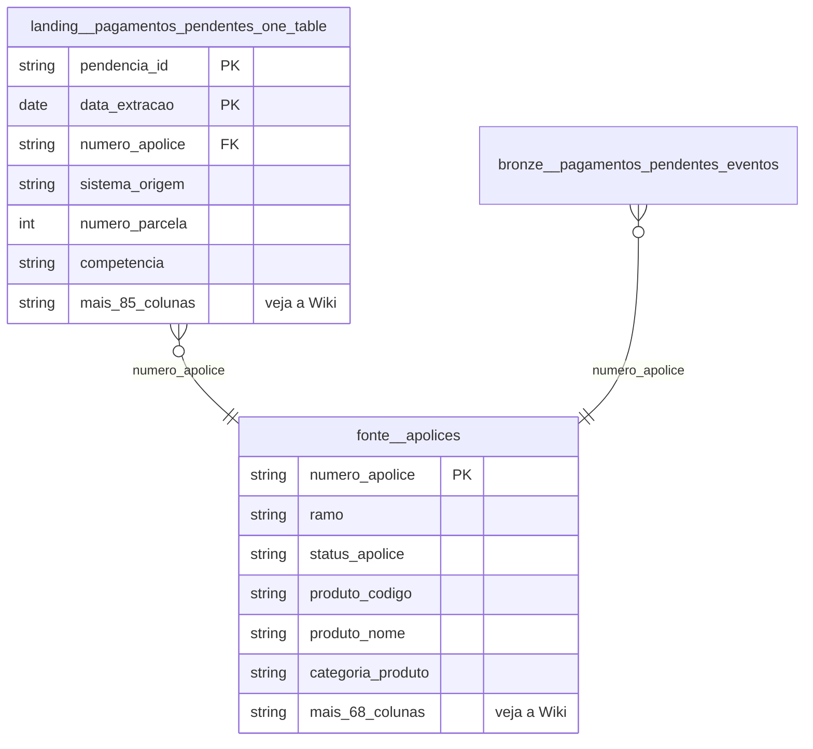

# Base origem · modelo de entidade e relacionamento

> Gerado por `governanca/modelo_dados.py` a partir do Unity Catalog. Não edite: rode `python3 governanca/modelo_dados.py gerar`.
> Schemas: `pos_venda.landing`, `pos_venda.fonte` · papel: **principal**.

Chegada dos dados: o arquivo único simulado (landing) e o cadastro de apólices do sistema de origem (fonte).

## Diagrama

Chave: `PK` (declarada no Unity Catalog ou lógica, ver a tabela abaixo) e `FK` (coluna que aponta para outra entidade).
Relacionamentos com outras bases aparecem com o nome completo da entidade (`schema__tabela`).

## Entidades

| Entidade | Tipo | Chave | Colunas | Descrição |
|---|---|---|---|---|
| `fonte.apolices` | managed | `numero_apolice` (lógica) | 74 | Cadastro de apolices do sistema de origem simulado (apolice, cliente, corretor, ponto de venda). Base do gerador diario de pendencias. |
| `landing.pagamentos_pendentes_one_table` | managed | `pendencia_id`, `data_extracao` (lógica; foto diária da origem; pode repetir) | 91 | One table sintetica de pagamentos pendentes de seguro de vida (dominio pos_venda). Grao: 1 parcela pendente por linha. Gerada com dbldatagen; contem defeitos de |

## Relacionamentos

| De | Para | Colunas | Cardinalidade | Tipo | O que significa |
|---|---|---|---|---|---|
| `landing.pagamentos_pendentes_one_table` | `fonte.apolices` | numero_apolice → numero_apolice | N:1 | lógico | o evento é de uma apólice do cadastro |
| `bronze.pagamentos_pendentes_eventos` | `fonte.apolices` | numero_apolice → numero_apolice | N:1 | lógico | o evento é de uma apólice do cadastro |

## Linhagem (Unity Catalog, últimos 90 dias)

| Entidade | Vem de | Alimenta |
|---|---|---|
| `fonte.apolices` | `landing.pagamentos_pendentes_one_table` | `bronze.pagamentos_pendentes_eventos` |
| `landing.pagamentos_pendentes_one_table` | `landing._stg_apolices` | `bronze_ldp.pagamentos_pendentes`, `bronze_sql.pagamentos_pendentes`, `fonte.apolices` |
