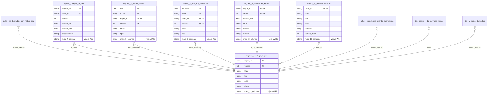

# Base regras · modelo de entidade e relacionamento

> Gerado por `governanca/modelo_dados.py` a partir do Unity Catalog. Não edite: rode `python3 governanca/modelo_dados.py gerar`.
> Schemas: `pos_venda.regras` · papel: **principal**.

Funções de cálculo, catálogo de regras de qualidade com vigência, triagem e retroalimentação (P20, P41).

## Diagrama

Chave: `PK` (declarada no Unity Catalog ou lógica, ver a tabela abaixo) e `FK` (coluna que aponta para outra entidade).
Relacionamentos com outras bases aparecem com o nome completo da entidade (`schema__tabela`).

## Entidades

| Entidade | Tipo | Chave | Colunas | Descrição |
|---|---|---|---|---|
| `regras.catalogo_regras` | managed | `regra_id`, `versao` (PK no Unity Catalog) | 17 | Catálogo das regras de qualidade do pos_venda, com versão e vigência pela data do dado (P41). Gerado por regras/catalogo/gerar_catalogo.py a partir de catalogo_ |
| `regras.triagem_regras` | managed | `triagem_id` (lógica) | 10 | Triagem das falhas de regra: cada semana com falha recebe uma classificação e uma ação. Fecha o ciclo de retroalimentação (P41): regra errada vira versão nova;  |
| `regras.v_falhas_regras` | view | `dia`, `fonte`, `regra_id` (lógica) | 12 | Falhas por dia, fonte, regra e versão vigente (P41). Na barreira, cada evento barrado conta só no primeiro motivo; no DQX, em todas as regras que violou. Base d |
| `regras.v_mudancas_regras` | view | `regra_id`, `versao` (lógica) | 8 | Mudanças de regra no tempo (P41): uma linha por versão com início de vigência. Os painéis marcam essas datas para explicar saltos na taxa de reprovação. |
| `regras.v_retroalimentacao` | view | `regra_id` (lógica) | 16 | Indicadores da retroalimentação por regra (P41): quanto falha, quanto falta triar, o que a triagem concluiu e a taxa de falso positivo. Uma regra com falso posi |
| `regras.v_triagem_pendente` | view | `semana`, `fonte`, `regra_id`, `versao` (lógica) | 12 | O que falta triar (P41): semanas em que a regra passou do limite aceito e nenhuma triagem cobre o período. Cada linha pede uma classificação em triagem_regras. |

## Relacionamentos

| De | Para | Colunas | Cardinalidade | Tipo | O que significa |
|---|---|---|---|---|---|
| `gold.dq_barrados_por_motivo_dia` | `regras.catalogo_regras` | motivo_rejeicao → regra_id | N:1 | lógico | barrados por uma regra de erro do catálogo |
| `regras.triagem_regras` | `regras.catalogo_regras` | regra_id → regra_id | N:1 | lógico | a triagem classifica as falhas de uma regra (e versão) |
| `regras.v_falhas_regras` | `regras.catalogo_regras` | regra_id, versao → regra_id, versao | N:1 | lógico | falhas do dia pela versão vigente |
| `regras.v_triagem_pendente` | `regras.catalogo_regras` | regra_id, versao → regra_id, versao | N:1 | lógico | semana a triar de uma versão |
| `regras.v_mudancas_regras` | `regras.catalogo_regras` | regra_id, versao → regra_id, versao | 1:1 | lógico | versão que começou a valer |
| `regras.v_retroalimentacao` | `regras.catalogo_regras` | regra_id → regra_id | 1:N | lógico | indicadores da regra em todas as versões |
| `silver.pendencia_evento_quarentena` | `regras.catalogo_regras` | motivo_rejeicao → regra_id | N:1 | lógico | o motivo de rejeição é uma regra de erro do catálogo |
| `dqx_codigo.dq_metricas_regras` | `regras.catalogo_regras` | regra → regra_id | N:1 | lógico | métrica de uma regra do catálogo |
| `dq.v_painel_barrados` | `regras.catalogo_regras` | motivo_rejeicao → regra_id | N:1 | lógico | barrados por uma regra de erro |

## Linhagem (Unity Catalog, últimos 90 dias)

| Entidade | Vem de | Alimenta |
|---|---|---|
| `regras.catalogo_regras` | — | `regras.v_falhas_regras`, `regras.v_mudancas_regras`, `regras.v_retroalimentacao` |
| `regras.triagem_regras` | — | `regras.v_retroalimentacao` |
| `regras.v_falhas_regras` | `bronze.pagamentos_pendentes_eventos`, `dqx_codigo.eventos_quarentena`, `dqx_codigo.eventos_validos`, `regras.catalogo_regras`, `silver.pendencia_evento_quarentena` | `regras.v_retroalimentacao`, `regras.v_triagem_pendente` |
| `regras.v_mudancas_regras` | `regras.catalogo_regras` | — |
| `regras.v_retroalimentacao` | `regras.catalogo_regras`, `regras.triagem_regras`, `regras.v_falhas_regras`, `regras.v_triagem_pendente` | — |
| `regras.v_triagem_pendente` | `regras.v_falhas_regras` | `regras.v_retroalimentacao` |
