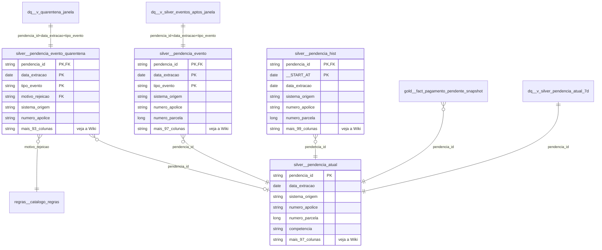

# Base silver · modelo de entidade e relacionamento

> Gerado por `governanca/modelo_dados.py` a partir do Unity Catalog. Não edite: rode `python3 governanca/modelo_dados.py gerar`.
> Schemas: `pos_venda.silver` · papel: **principal**.

Eventos aptos, histórico SCD2 e foto atual de cada pendência; o que a barreira reprovou vai para a quarentena (P09).

## Diagrama

Chave: `PK` (declarada no Unity Catalog ou lógica, ver a tabela abaixo) e `FK` (coluna que aponta para outra entidade).
Relacionamentos com outras bases aparecem com o nome completo da entidade (`schema__tabela`).

## Entidades

| Entidade | Tipo | Chave | Colunas | Descrição |
|---|---|---|---|---|
| `silver.pendencia_atual` | streaming table | `pendencia_id` (lógica) | 103 | Silver estado atual: 1 linha por pendencia_id com o ultimo estado conhecido (SCD1). Base das dimensoes da gold. |
| `silver.pendencia_evento` | streaming table | `pendencia_id`, `data_extracao`, `tipo_evento` (lógica; não única: a origem reenvia eventos idênticos; duplicata é aviso (dq_qualidade_diaria.eventos_duplicados)) | 103 | Silver: todos os eventos de pendencia recebidos (append), com CPF/RG/telefone/CEP/UF padronizados e flags de qualidade (dq_*). |
| `silver.pendencia_evento_quarentena` | streaming table | `pendencia_id`, `data_extracao`, `tipo_evento` (lógica; não única: a origem reenvia eventos idênticos; duplicata é aviso (dq_qualidade_diaria.eventos_duplicados); o motivo está em motivo_rejeicao) | 99 | Quarentena: eventos do bronze que violaram uma regra de erro e foram barrados antes da silver. Guarda a linha original e o motivo da rejeicao. |
| `silver.pendencia_hist` | streaming table | `pendencia_id`, `__START_AT` (lógica; SCD tipo 2: uma linha por versão) | 105 | Silver historica (SCD2): uma linha por versao da pendencia. Uma nova versao nasce quando o status de cobranca muda ou a parcela e paga. __START_AT/__END_AT = vi |

## Relacionamentos

| De | Para | Colunas | Cardinalidade | Tipo | O que significa |
|---|---|---|---|---|---|
| `silver.pendencia_evento` | `silver.pendencia_atual` | pendencia_id → pendencia_id | N:1 | lógico | os eventos aptos formam a foto atual da pendência |
| `silver.pendencia_hist` | `silver.pendencia_atual` | pendencia_id → pendencia_id | N:1 | lógico | cada versão SCD2 é de uma pendência |
| `silver.pendencia_evento_quarentena` | `silver.pendencia_atual` | pendencia_id → pendencia_id | N:0..1 | lógico | evento barrado; a pendência pode nem existir na silver |
| `gold.fact_pagamento_pendente_snapshot` | `silver.pendencia_atual` | pendencia_id → pendencia_id | N:1 | lógico | a foto diária vem da pendência da silver |
| `silver.pendencia_evento_quarentena` | `regras.catalogo_regras` | motivo_rejeicao → regra_id | N:1 | lógico | o motivo de rejeição é uma regra de erro do catálogo |
| `dq.v_quarentena_janela` | `silver.pendencia_evento_quarentena` | pendencia_id, data_extracao, tipo_evento → pendencia_id, data_extracao, tipo_evento | 1:1 | lógico | janela da quarentena |
| `dq.v_silver_eventos_aptos_janela` | `silver.pendencia_evento` | pendencia_id, data_extracao, tipo_evento → pendencia_id, data_extracao, tipo_evento | 1:1 | lógico | janela dos eventos aptos |
| `dq.v_silver_pendencia_atual_7d` | `silver.pendencia_atual` | pendencia_id → pendencia_id | 1:1 | lógico | janela da foto atual |

## Linhagem (Unity Catalog, últimos 90 dias)

| Entidade | Vem de | Alimenta |
|---|---|---|
| `silver.pendencia_atual` | `silver.pendencia_evento` | `dq.v_silver_pendencia_atual_7d`, `gold.bridge_apolice_cobertura`, `gold.dim_apolice`, `gold.dim_cliente`, `gold.dim_corretor`, `gold.dim_ponto_venda`, `gold.dim_produto`, `ontologia.pendencia` |
| `silver.pendencia_evento` | `bronze.pagamentos_pendentes_eventos` | `dq.v_silver_eventos_aptos_janela`, `gold.dq_qualidade_diaria`, `ontologia.evento_cobranca`, `ontologia.pagamento`, `silver.pendencia_atual`, `silver.pendencia_hist` |
| `silver.pendencia_evento_quarentena` | `bronze.pagamentos_pendentes_eventos` | `dq.v_painel_quarentena`, `dq.v_quarentena_janela`, `gold.dq_barrados_por_motivo_dia`, `gold.dq_qualidade_diaria`, `regras.v_falhas_regras` |
| `silver.pendencia_hist` | `silver.pendencia_evento` | `dq.v_silver_hist_janela`, `dq.v_silver_pendencia_hist_7d`, `gold.fact_pagamento_pendente_snapshot` |
