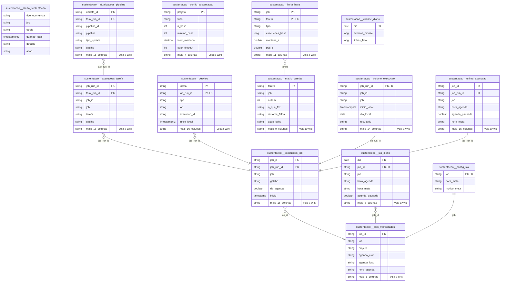

# Base sustentacao · modelo de entidade e relacionamento

> Gerado por `governanca/modelo_dados.py` a partir do Unity Catalog. Não edite: rode `python3 governanca/modelo_dados.py gerar`.
> Schemas: `pos_venda.sustentacao` · papel: **apoio**.

Tempo de execução por job, tarefa e pipeline, linha de base, desvios, SLA e volume (P40).

## Diagrama

Chave: `PK` (declarada no Unity Catalog ou lógica, ver a tabela abaixo) e `FK` (coluna que aponta para outra entidade).
Relacionamentos com outras bases aparecem com o nome completo da entidade (`schema__tabela`).

## Entidades

| Entidade | Tipo | Chave | Colunas | Descrição |
|---|---|---|---|---|
| `sustentacao.alerta_sustentacao` | view | sem chave declarada | 6 | O que o alerta SQL diário avisa: SLA estourado hoje e desvios da carga diária nas últimas 24 horas que passaram do limite por 60 s ou mais sem ser volume, com a |
| `sustentacao.atualizacoes_pipeline` | view | `update_id` (lógica) | 21 | Uma linha por atualização (update) dos pipelines Lakeflow do projeto: duração, espera antes do update, resultado e a tarefa do job que disparou (system.lakeflow |
| `sustentacao.config_sla` | view | `job` (lógica) | 3 | Jobs com hora meta (SLA): a execução da agenda precisa terminar até esta hora, no horário de Brasília. |
| `sustentacao.config_sustentacao` | view | `projeto` (lógica) | 10 | Parâmetros da sustentação: fuso, tamanho da linha de base, critério de desvio, janela do alerta e calendário do SLA. |
| `sustentacao.desvios` | view | `job_run_id`, `tarefa` (lógica) | 22 | Execuções com sucesso acima do normal: duração acima do p95 ou de 1.5 vez a mediana das 20 execuções anteriores (mínimo de 5), com o excesso e a causa provável. |
| `sustentacao.execucoes_job` | view | `job_run_id` (lógica) | 22 | Uma linha por execução de job do projeto: início e fim (UTC e horário de Brasília), duração, fila, setup, resultado, gatilho e o intervalo carregado (system.lak |
| `sustentacao.execucoes_tarefa` | view | `task_run_id` (lógica) | 24 | Uma linha por execução de tarefa dos jobs do projeto: início, fim, duração, setup, execução, resultado e tentativas (system.lakeflow.job_task_run_timeline). |
| `sustentacao.jobs_monitorados` | view | `job_id` (lógica) | 11 | Jobs do projeto pos_venda (atribuição da FinOps), com a agenda, o timeout e a hora meta do SLA. |
| `sustentacao.linha_base` | view | `job`, `tarefa` (lógica) | 17 | Linha de base de duração por job, tarefa e pipeline: mediana e p95 das últimas 20 execuções com sucesso, o limite de desvio e o timeout sugerido. Com menos de 5 |
| `sustentacao.matriz_tarefas` | view | `tarefa` (lógica) | 15 | Matriz de resiliência por tarefa da carga diária (P28): o que a tarefa faz, sintoma e ação na falha e na lentidão, com a linha de base e a última execução. |
| `sustentacao.sla_diario` | view | `dia`, `job_id` (lógica) | 14 | SLA dos jobs com hora meta, dia a dia (últimos 30 dias, horário de Brasília): execuções da agenda e manuais, fim, atraso e situação. Só a execução da agenda con |
| `sustentacao.ultima_execucao` | view | `job_id` (lógica) | 21 | Última execução de cada job do projeto, comparada com a linha de base, com o atraso sobre a meta (se veio da agenda), a folga projetada até a meta e o timeout s |
| `sustentacao.volume_diario` | view | `dia` (lógica) | 3 | Volume por dia: eventos do bronze por data_extracao e linhas da fato histórica por foto (data_referencia_sk). |
| `sustentacao.volume_execucao` | view | `job_run_id` (lógica) | 20 | Volume de cada execução da carga diária: dias do intervalo, eventos gravados no bronze e linhas gravadas na fato, com a duração. Separa lentidão de aumento de v |

## Relacionamentos

| De | Para | Colunas | Cardinalidade | Tipo | O que significa |
|---|---|---|---|---|---|
| `sustentacao.execucoes_job` | `sustentacao.jobs_monitorados` | job_id → job_id | N:1 | lógico | execução de um job monitorado |
| `sustentacao.execucoes_tarefa` | `sustentacao.execucoes_job` | job_run_id → job_run_id | N:1 | lógico | tarefa de uma execução |
| `sustentacao.atualizacoes_pipeline` | `sustentacao.execucoes_tarefa` | task_run_id → task_run_id | N:1 | lógico | update do pipeline disparado por uma tarefa |
| `sustentacao.desvios` | `sustentacao.execucoes_job` | job_run_id → job_run_id | N:1 | lógico | desvio numa execução |
| `sustentacao.volume_execucao` | `sustentacao.execucoes_job` | job_run_id → job_run_id | 1:1 | lógico | volume de uma execução |
| `sustentacao.ultima_execucao` | `sustentacao.execucoes_job` | job_run_id → job_run_id | 1:1 | lógico | última execução de cada job |
| `sustentacao.sla_diario` | `sustentacao.jobs_monitorados` | job_id → job_id | N:1 | lógico | SLA diário de um job |
| `sustentacao.linha_base` | `sustentacao.matriz_tarefas` | tarefa → tarefa | N:1 | lógico | linha de base da tarefa e o que fazer |
| `sustentacao.config_sla` | `sustentacao.jobs_monitorados` | job → job | 1:1 | lógico | meta de horário de um job |

## Linhagem (Unity Catalog, últimos 90 dias)

| Entidade | Vem de | Alimenta |
|---|---|---|
| `sustentacao.alerta_sustentacao` | `sustentacao.desvios`, `sustentacao.matriz_tarefas`, `sustentacao.sla_diario` | — |
| `sustentacao.atualizacoes_pipeline` | `finops.config_atribuicao`, `sustentacao.execucoes_tarefa` | `sustentacao.desvios`, `sustentacao.linha_base` |
| `sustentacao.config_sla` | — | `sustentacao.jobs_monitorados` |
| `sustentacao.config_sustentacao` | — | — |
| `sustentacao.desvios` | `sustentacao.atualizacoes_pipeline`, `sustentacao.execucoes_job`, `sustentacao.execucoes_tarefa`, `sustentacao.volume_execucao` | `sustentacao.alerta_sustentacao` |
| `sustentacao.execucoes_job` | `sustentacao.jobs_monitorados` | `sustentacao.desvios`, `sustentacao.execucoes_tarefa`, `sustentacao.linha_base`, `sustentacao.sla_diario`, `sustentacao.ultima_execucao`, `sustentacao.volume_execucao` |
| `sustentacao.execucoes_tarefa` | `sustentacao.execucoes_job` | `sustentacao.atualizacoes_pipeline`, `sustentacao.desvios`, `sustentacao.linha_base`, `sustentacao.matriz_tarefas` |
| `sustentacao.jobs_monitorados` | `finops.config_atribuicao`, `sustentacao.config_sla` | `sustentacao.execucoes_job`, `sustentacao.sla_diario`, `sustentacao.ultima_execucao` |
| `sustentacao.linha_base` | `sustentacao.atualizacoes_pipeline`, `sustentacao.execucoes_job`, `sustentacao.execucoes_tarefa` | `sustentacao.matriz_tarefas`, `sustentacao.ultima_execucao` |
| `sustentacao.matriz_tarefas` | `sustentacao.execucoes_tarefa`, `sustentacao.linha_base` | `sustentacao.alerta_sustentacao` |
| `sustentacao.sla_diario` | `sustentacao.execucoes_job`, `sustentacao.jobs_monitorados` | `sustentacao.alerta_sustentacao` |
| `sustentacao.ultima_execucao` | `sustentacao.execucoes_job`, `sustentacao.jobs_monitorados`, `sustentacao.linha_base` | — |
| `sustentacao.volume_diario` | `bronze.pagamentos_pendentes_eventos`, `gold.fact_pagamento_pendente_snapshot` | — |
| `sustentacao.volume_execucao` | `bronze.pagamentos_pendentes_eventos`, `gold.fact_pagamento_pendente_snapshot`, `sustentacao.execucoes_job` | `sustentacao.desvios` |
